# Introduction to Slunk

Slunk keeps track of a music collection. This document is the starting point for the project. It covers:
- what Slunk is and what it must do;
- its data model;
- how the database evolves through migrations;
- how the backend is organized;
- the frontend's routes, and what each one shows;
- the phases to build it in.

**Design docs.** Slunk's design lives in `docs/design/`, one numbered document per topic (`N_topic.md`), numbered in the order they're written. This one comes first, and later documents build on it.

Design docs are plans, and after that a history of the project. A design doc is only edited while that design is being developed. After that its text stays as it was: when the code shows something has to change, the change is added as an appendix at the end of the doc. What's actually built is documented in the rest of `docs/` ([docs/README.md](../README.md)), and those docs are kept up to date with the code.

| Document | Covers |
|---|---|
| `1_introduction.md` | This document: the foundations listed above |
| `2_external_libraries.md` | Exporting music to other libraries. Planned, not written yet |

## 1. Summary

- Slunk owns a database that is the source of truth for all music metadata. It's a record keeper: it never writes to the user's files, and only records where they are.
- The data model covers:
  - files, artists, labels, releases and tracks;
  - release formats (Album, EP, Single, …) and media (CD, Vinyl, …), several of each per release;
  - the labels each release came out on, and its catalog number;
  - who performs each release and track, credits with user-defined roles, and various-artists releases;
  - file links;
  - typed tags, each single- or multi-value.

  The database itself enforces integrity: `STRICT` tables, foreign keys, CHECKs and triggers.
- Migrations are timestamped TypeScript files in `slunk-be/priv/repo/migrations/`, applied by a small runner built on Kysely. They come with Ecto-style commands (`db:migrate`, `db:rollback`, `db:gen`, …). All pending migrations apply in one transaction, after a backup.
- Backend: Node 26 (runs TypeScript natively), Apollo Server 5 on Express 5, Kysely + better-sqlite3, and Phoenix-style contexts.
- Frontend: every route is listed with what it shows, and loads only that. Release and artist pages follow Discogs, the other entities get plain CRUD pages, and importing a folder is a step-by-step flow with a route per step.
- Phases: **0** Foundations → **1** Files → **2** Catalog → **3** Tags → **4** Integrity. Exporting to external libraries comes later, designed in its own doc.

## 2. What Slunk is

Music libraries usually treat the tags embedded in each file as the source of truth. Slunk is its own source of truth instead: it owns a database with all the music's metadata. That lets metadata be stored more accurately than file tags allow, and queried fast.

- **A record keeper.** Slunk never writes to the user's files: no moving, copying, renaming or retagging. The user decides where files live, and Slunk records each file's path relative to its database. The library keeps working as long as the database stays in the same place relative to the files. Removing a file in Slunk only deletes its record, and only once nothing in Slunk uses it.
- **Local.** Slunk runs on the user's machine, so there are no deployments to think about. It handles file operations itself: reading, hashing and serving files to its UI.
- **A proof of concept.** Speed of development comes first everywhere except the database. The database is the one part designed carefully, for the long term.
- **Export comes later.** Slunk's second goal is to export music to other libraries. It still needs planning and will get its own design doc, `2_external_libraries.md`. Until then, the focus is on organizing.

## 3. Requirements

### 3.1 Technical

- One repository, two projects:
  - `slunk-be`, the backend, on Node.js, with its version pinned through mise in a `.tool-versions` file.
  - `slunk-fe`, the frontend, on Vite + React + React Router. A skeleton already exists. It uses shadcn, so all UI code follows shadcn's conventions.
- **Backend:**
  - processes data and answers the frontend's requests;
  - exposes a GraphQL API compliant with Apollo;
  - follows DDD with the repository pattern, structured like Elixir's Phoenix.
- **Database:** SQLite. Because of the repository pattern, it can be swapped for another database later. A migration system must let new migrations be added at any time.

### 3.2 Domain

**Files.** The user registers files that already exist on disk. Each file is a track's audio (`music`), an `image`, or something else (`other`, e.g. a booklet PDF or a rip log). Once registered, files are connected to the data:
- every track is one audio file, and an audio file belongs to at most one track;
- images and other files can be linked to any number of releases, artists and tracks.

**Entities.** The user creates these and connects them:

- **Artists:** any person or group making music, or related to making it. For example U2, Billie Joe Armstrong, Mozart, the Vienna Symphony Orchestra, or "Various Artists".
- **Releases:** a set of tracks published together, such as an album, an EP or a single. Each release has formats from a list the user manages, and can have several: U2 & Green Day's "The Saints Are Coming" is a Single, and a vinyl album can be both an LP and an Album. Releases also have media, from a second list: what they're on, such as CD or Vinyl. A release can have many artists. On some releases each track names its own performers, for example a compilation by "Various Artists", or a soundtrack by "The High School Musical Cast" where each song names its singers.
- **Labels:** the record labels a release came out on, such as Interscope, XL Recordings or Rough Trade. A release can have several: Drake's "Nothing Was the Same" carries Cash Money Records, Republic Records, Young Money Entertainment and October's Very Own. A release also has a catalog number, the label's identifier for it, printed on the spine or back cover (`B0019141-02` on the US CD).
- **Tracks:** one unit of music. Every track belongs to one release and is created from one registered audio file. A track names who performs it, which can differ from the release's artists. It can also have guests (features): "Hold On, We're Going Home" by Drake features Majid Jordan.
- **Credits:** everyone else who worked on a release or track, each with a role: producer, writer, conductor, an instrument such as saxophone. The user manages the list of roles.
- **Tags:** arbitrary metadata on releases, such as Genre, Barcode, Date purchased, Score or Price (USD).
  - Each data type (text, real number, date) has its own tables, so each type is queried with its own operators: text matching, numeric ranges, date ranges.
  - The same design extends later to tags on tracks.

## 4. Data model

### 4.1 Library layout and connection

The database path is set with `SLUNK_DB`. The user's files stay wherever the user keeps them, and Slunk only writes next to the database:

```
~/Music/                      ← the user's library, organized however they like
  slunk.db                    ← SLUNK_DB
  slunk.db-wal, slunk.db-shm  ← SQLite's WAL files
  slunk-backups/              ← pre-migration copies
  Drake/Nothing Was the Same/12 Hold On, We're Going Home.flac
      ↳ files.path = "Drake/Nothing Was the Same/12 Hold On, We're Going Home.flac"
```

Paths in `files.path`:
- are relative to the folder holding `slunk.db` and never absolute, so the database and the files can move together;
- may start with `../` when files sit outside that folder;
- are normalized before they're stored (forward slashes, no `./` or `a/../b`), so one file has exactly one path.

The app's connection sets `foreign_keys = ON`, `journal_mode = WAL` and `busy_timeout = 5000`.

### 4.2 Conventions

- **Strict typing:** every table is `STRICT`, so SQLite rejects, say, text in an integer column.
- **Ids:** `files`, `artists`, `labels`, `releases` and `tracks` use `INTEGER PRIMARY KEY AUTOINCREMENT`, so a deleted id is never reused. Anything that remembers an id outside the database can't end up pointing at a different row. Other tables use `INTEGER PRIMARY KEY`.
- **Time:** instants (dates, timestamps) are Unix epoch seconds, UTC. Durations are milliseconds.
- **Timestamps:** `inserted_at` / `updated_at` exist on files, artists, labels, releases and tracks. Both default to `unixepoch()`, and the repositories set `updated_at`.
- **Foreign keys:** SQLite ignores foreign keys unless `PRAGMA foreign_keys = ON` is set on the connection, so every connection sets it. SQLite also doesn't index foreign key columns, so every FK column leads some index. Without that index, a delete scans the child table.
- **Delete rules:**
  - CASCADE for pure link rows, when the release, artist or track they describe is deleted.
  - RESTRICT for anything still in use:
    - a release with tracks;
    - a linked or credited artist;
    - a label on a release;
    - a tag definition, credit role, release format or medium in use;
    - a file used anywhere: a track's audio, a cover, a picture or a file link.
- **Naming:** join tables name both sides in alphabetical order: `artists_releases`, `artists_tracks`, `files_tracks`, `labels_releases`, `release_formats_releases`, `release_media_releases`. Credit and tag value tables hold more than a link (a role, a value), so they're named after their owner instead: `release_credits`, `track_credits`, `release_text_tags`. That also keeps the three tag value tables alike, where alphabetical order would give `date_tags_releases` but `releases_text_tags`.

### 4.3 Design decisions

> Changed during implementation, see [Appendix A](#appendix-a-more-integrity-rules-in-the-database) and [Appendix D](#appendix-d-tag-values-are-checked-in-the-database).

**Files.**
- `path` is relative, as described in §4.1.
- `size_bytes`, `mtime` and `sha256` let a library check notice changes made outside Slunk:
  - a changed size or mtime means the file needs rehashing;
  - a known hash at a new path means the file moved.
- `sha256` is indexed but not unique. The library may hold the same content twice (one `cover.jpg` per disc folder), and Slunk records what's there.
- `type` is one of `music`, `image`, `other`. A track's file must be `music`, which the app checks when the track is created.
- A file record can only be deleted once nothing uses it: it must not be a track's audio, a cover, a picture, or in a file link. Forgetting a file never silently clears a cover or removes it from a release.
- A file that disappeared from disk keeps its record until the user relinks or unlinks it. The library check shows where it's still used.

**Tracks.**
- `release_id` is required.
- `file_id` is required and unique: every track is an audio file the user has, and tracks are created from registered audio files.
- A file that is a track's audio can't be deleted (RESTRICT); the track goes first. If the file moves on disk, the library check relinks it by hash.
- `duration_ms` is read from the file when the track is created. It's nullable only for files whose duration can't be read.
- `cd_number` defaults to 1.
- `(release_id, cd_number, track_number)` is unique. The same index returns a release's tracks in order.

**Releases.**
- A release's size is computed from its tracks: tracks per disc, and the highest `cd_number` for the number of discs.
  - Every track is a file the user has, so no stored total can disagree with the tracks.
  - The trade-off: an incomplete release (10 of 12 tracks) can't record that it has 12. A later migration can add that if it's ever needed.
- `cover_picture` and `artists.picture` point to the *primary* image. Other images go through file links.

**Release formats.**
- A format says what kind of release it is: an Album, an EP, a Single, an LP. An album is one format of release, not a release itself, which is why the entity is called a release.
- A release can have several formats, e.g. a vinyl album is both `LP` and `Album`, and a soundtrack can be `Album` and `Soundtrack`. `release_formats_releases` links them. A release can also have none yet.
- Formats are plain data the user manages, like credit roles. A format still in use can't be deleted.
- Names are stored as they're displayed ("EP", not "ep"), and are unique ignoring case.
- The baseline migration adds starter formats: `Album`, `Compilation`, `EP`, `Live`, `LP`, `Mixtape`, `Single`, `Soundtrack`. Nothing depends on them.

**Release media.**
- A medium says what a release is on: `CD`, `Vinyl`, `Cassette`, `Digital`. Formats say what kind of release it is, and media what it's on. They're kept in separate lists so each stays clear, and filters like "EPs on vinyl" need no special case.
- `LP` stays a format: a vinyl album has the medium `Vinyl` and the formats `LP` and `Album`.
- A release can have several media, e.g. a box set with CDs and a DVD. `release_media_releases` links them. A release can also have none.
- Media work like formats: the user manages the list, names are stored as they're displayed and unique ignoring case, and a medium still in use can't be deleted.
- The baseline migration adds starter media: `Cassette`, `CD`, `Digital`, `Vinyl`. Nothing depends on them.
- The trade-off: media belong to the release, not to each disc. That box set records `CD` and `DVD`, but not which disc is which. A later migration can add per-disc media if it's ever needed.

**Labels.**
- A label is the brand a release came out on, named as it's printed on the sleeve: Interscope, XL Recordings, Rough Trade. It's usually an imprint, not the company that owns it.
- A release can have several labels, because deals are layered and every label involved gets its logo on the record. "Nothing Was the Same" is on October's Very Own (Drake's own label), Young Money (the label that signed him), Cash Money (Young Money's parent) and Republic Records (the Universal label they release through). `labels_releases` links them, and `position` is the display order. A label appears at most once per release, and a release can have none yet.
- Labels are entities with their own page, like artists:
  - Names aren't unique, because two labels can share a name.
  - `picture` points to the label's logo, the same way `artists.picture` points to the artist's primary image.
  - A label still on a release can't be deleted.
- A self-released record links to an ordinary "Not On Label" label that the user creates, the same way a compilation uses a "Various Artists" artist. A release with no labels just hasn't had them entered yet.
- Only labels are recorded. Other companies printed on a release aren't: ℗ and © holders, distributors, pressing plants, studios. If they're ever needed, a later migration can add them as roles and credits, like `credit_roles` and `release_credits`.
- The trade-off: labels have no hierarchy. Parent labels and imprints aren't recorded, so "everything on a Universal label" isn't a query. Ownership also changes over time. A later migration can add `labels.parent_id` if it's ever needed. Labels also have no file links yet, only the logo.

**Catalog numbers.**
- `releases.catalog_number` is the identifier a label gives a release, printed on the spine, back cover or disc (`B0019141-02`). Each edition of a record has its own number, which is why it's on the release.
- A release has one catalog number, even when several labels are printed: all four labels on the US CD of "Nothing Was the Same" share `B0019141-02`. A set numbered as a range is written as printed (`ECM 1064/65`).
- Numbers are stored as printed and never normalized, so `B0019141-02` and `B001914102` stay as entered. A CHECK rejects empty strings and leading or trailing spaces. Numbers compare ignoring case.
- Numbers aren't unique: two editions can share one, and the user may own two copies of a release.
- The barcode, printed next to the catalog number, isn't a column. It's a text tag.
- The trade-off: Slunk doesn't record which label gave the number, or two separate numbers on one release (an indie co-release where each label numbers it). A later migration can move the number onto `labels_releases` if it's ever needed.

**Dates.**
- Dates are Unix epoch seconds, UTC. An unknown month or day becomes the first one (`1987` → `1987-01-01T00:00:00Z`). Pre-1970 dates are negative numbers, which works.
- `releases.release_date_precision` (`year`, `month` or `day`) records which parts of the release date are known. That's how "1987" and "1987-01-01" are told apart, and the UI shows only the known parts. Two CHECKs keep the pair consistent:
  - `release_date` and `release_date_precision` are both set or both NULL;
  - the date sits at midnight UTC on the first day of its year or month, matching its precision.
- Date tag values have no precision column and follow the same first-day rule.

**Artists and credits.** Two kinds of links are kept apart, because the app treats them differently:
- **Release and track artists** have a fixed meaning: who the release is by, and who performs each track. They name the release or track, e.g. "Start of Something New — Zac Efron / Vanessa Anne Hudgens".
- **Credits** list everyone else who worked on it, each with a role. They're shown underneath, e.g. "Producer – Mathew Gerrard".

Performers have their own tables, so nothing depends on a particular role existing. Deleting or renaming a role can't change who performs a track.

Release and track artists:
- `artists_releases` holds who the release is by.
- `artists_tracks` holds who performs the track. `featured` (0 or 1, default 0) marks guests, shown as "(feat. …)".
- `position` is the display order ("U2 & Green Day", not "Green Day & U2").
- An artist appears at most once per release or track.

Credits:
- `release_credits` and `track_credits` link an artist to a release or track with a role from `credit_roles`.
- Roles are plain data the user manages, like tag definitions: producer, writer, conductor, an instrument such as saxophone. A role still in use can't be deleted.
- The baseline migration adds starter roles: `composer`, `conductor`, `producer`, `remixer`, `writer`.
- An artist can hold several roles on the same track (producer and writer), and can also be one of its performers.
- `position` is the display order.

**Various-artists releases.** `releases.various_artists` (0 or 1, default 0) marks a release whose tracks each name their own performers: compilations, soundtracks, cast recordings. The release still has artists of its own, either an umbrella name like "The High School Musical Cast" or a plain "Various Artists" artist. So every release has an artist, and sorting or grouping by release artist needs no special case.

Who performs a track:
- **On a regular release:** the track's own non-featured artists, or the release's artists if the track has none.
- **On a various-artists release:** only the track's own non-featured artists, with no fallback. A track sung by the whole cast lists the cast explicitly. A missing artist then gets reported by the library check (phase 4) instead of silently showing the umbrella name.
- **On either kind:** the track's featured artists are added as "(feat. …)".

The UI follows the flag. A various-artists release shows each track's artists in its track list, while a regular release shows only the features.

Examples:
- **Drake, "Nothing Was the Same":** a regular release by Drake, in the `Album` format. "Hold On, We're Going Home" lists only Majid Jordan, as featured, so Drake performs it: "Hold On, We're Going Home (feat. Majid Jordan)".
- **"High School Musical (Soundtrack)":** a various-artists release by The High School Musical Cast, in the `Album` and `Soundtrack` formats.
  - "Start of Something New" is performed by Zac Efron and Vanessa Anne Hudgens. Its credits are Producer – Mathew Gerrard, and Writer – Mathew Gerrard, Robbie Nevil.
  - "Stick to the Status Quo" is performed by The High School Musical Cast.
- **"The Metallica Blacklist":** a various-artists release by Various Artists. "Nothing Else Matters" is performed by Miley Cyrus, with James Hetfield and Lars Ulrich credited as `writer`.
- **A Mozart recording:** the orchestra performs, Mozart is credited as `composer`, and the conductor as `conductor`.

**File links.** `files_releases`, `artists_files` and `files_tracks` link images and other files to entities. Each link has an optional `note` (e.g. "back cover").

**Tags.**
- Each type has a definition table (`text_tags`, `real_number_tags`, `date_tags`) and a value table (`release_text_tags`, `release_real_number_tags`, `release_date_tags`). The value column has the real type, so numbers and dates compare as numbers.
- `(release_id, tag_id, value)` is unique, which prevents duplicate values.
- `(tag_id, value)` is indexed, which makes filters fast ("Genre = Rock", "Score ≥ 8").
- Tag names and text values use `COLLATE NOCASE`, so "Rock" and "rock" are the same.
- Tag names can repeat across types ("Score" as text and as a real number), so the app checks for that when a tag is created.

**Single-value tags.** Each tag definition has `multiple` (0 or 1, default 0):
- **Single-value (`multiple = 0`):** at most one value per release. Most tags are like this: Score, Price, Date purchased.
- **Multi-value (`multiple = 1`):** several values per release, like Genre.

Without the flag, nothing could keep a tag single-valued. A double submit, or a bulk edit that adds instead of replacing, would leave a release with both Score 6 and Score 9. Sorting by Score would then have to pick one value, "Score ≥ 8" would match the release because of the 9, and an average would count it twice.

Triggers enforce the flag (§4.4). The UI uses it to pick its control: one input that replaces the value, or a list that adds values.

### 4.4 Schema

```mermaid
erDiagram
    files {
        int id PK
        text path UK "relative to the slunk.db folder"
        text type "music, image or other"
        int size_bytes
        int mtime "epoch s"
        text sha256
        int inserted_at
        int updated_at
    }
    artists {
        int id PK
        text name
        int picture FK "nullable"
        int inserted_at
        int updated_at
    }
    labels {
        int id PK
        text name
        int picture FK "nullable"
        int inserted_at
        int updated_at
    }
    releases {
        int id PK
        text title
        int release_date "nullable, epoch s"
        text release_date_precision "nullable; year, month or day"
        text catalog_number "nullable, as printed"
        int cover_picture FK "nullable"
        int various_artists "0 or 1, default 0"
        int inserted_at
        int updated_at
    }
    tracks {
        int id PK
        text title
        int duration_ms "nullable"
        int track_number
        int cd_number "default 1"
        int release_id FK
        int file_id FK, UK
        int inserted_at
        int updated_at
    }
    artists_releases {
        int id PK
        int artist_id FK
        int release_id FK
        int position "display order"
    }
    artists_tracks {
        int id PK
        int artist_id FK
        int track_id FK
        int featured "0 or 1, default 0"
        int position "display order"
    }
    labels_releases {
        int id PK
        int label_id FK
        int release_id FK
        int position "display order"
    }
    credit_roles {
        int id PK
        text name UK "producer, writer..."
    }
    release_credits {
        int id PK
        int release_id FK
        int artist_id FK
        int role_id FK
        int position "display order"
    }
    track_credits {
        int id PK
        int track_id FK
        int artist_id FK
        int role_id FK
        int position "display order"
    }
    release_formats {
        int id PK
        text name UK "Album, EP, Single..."
    }
    release_formats_releases {
        int id PK
        int format_id FK
        int release_id FK
    }
    release_media {
        int id PK
        text name UK "CD, Vinyl..."
    }
    release_media_releases {
        int id PK
        int medium_id FK
        int release_id FK
    }
    files_releases {
        int id PK
        int file_id FK
        int release_id FK
        text note "nullable"
    }
    artists_files {
        int id PK
        int artist_id FK
        int file_id FK
        text note "nullable"
    }
    files_tracks {
        int id PK
        int file_id FK
        int track_id FK
        text note "nullable"
    }
    text_tags {
        int id PK
        text name UK
        int multiple "0 or 1, default 0"
    }
    real_number_tags {
        int id PK
        text name UK
        int multiple "0 or 1, default 0"
    }
    date_tags {
        int id PK
        text name UK
        int multiple "0 or 1, default 0"
    }
    release_text_tags {
        int id PK
        int release_id FK
        int tag_id FK
        text value
    }
    release_real_number_tags {
        int id PK
        int release_id FK
        int tag_id FK
        real value
    }
    release_date_tags {
        int id PK
        int release_id FK
        int tag_id FK
        int value "epoch s"
    }

    releases ||--o{ tracks : contains
    files ||--o| tracks : "audio of"
    files |o--o{ releases : "cover of"
    files |o--o{ artists : "picture of"
    files |o--o{ labels : "picture of"

    releases ||--o{ artists_releases : "is by"
    artists ||--o{ artists_releases : "artist of"
    tracks ||--o{ artists_tracks : "performed by"
    artists ||--o{ artists_tracks : performs

    releases ||--o{ labels_releases : "released on"
    labels ||--o{ labels_releases : "label of"

    releases ||--o{ release_credits : credits
    tracks ||--o{ track_credits : credits
    artists ||--o{ release_credits : "credited on"
    artists ||--o{ track_credits : "credited on"
    credit_roles ||--o{ release_credits : "role of"
    credit_roles ||--o{ track_credits : "role of"

    releases ||--o{ release_formats_releases : "has format"
    release_formats ||--o{ release_formats_releases : "format of"
    releases ||--o{ release_media_releases : "is on"
    release_media ||--o{ release_media_releases : "medium of"

    releases ||--o{ files_releases : has
    artists ||--o{ artists_files : has
    tracks ||--o{ files_tracks : has
    files ||--o{ files_releases : "linked as"
    files ||--o{ artists_files : "linked as"
    files ||--o{ files_tracks : "linked as"

    releases ||--o{ release_text_tags : has
    releases ||--o{ release_real_number_tags : has
    releases ||--o{ release_date_tags : has
    text_tags ||--o{ release_text_tags : "value of"
    real_number_tags ||--o{ release_real_number_tags : "value of"
    date_tags ||--o{ release_date_tags : "value of"
```



#### Constraints & indexes

> Changed during implementation, see [Appendix A](#appendix-a-more-integrity-rules-in-the-database) and [Appendix D](#appendix-d-tag-values-are-checked-in-the-database).

Every table is `STRICT`.

**files**
- `path` unique · index `sha256` (not unique: the same content may sit at two paths)
- `type` in (`music`, `image`, `other`) · `size_bytes >= 0`

**artists**
- index `name COLLATE NOCASE` · index `picture`
- `picture` → files, ON DELETE RESTRICT

**labels**
- index `name COLLATE NOCASE` · index `picture`
- `picture` → files, ON DELETE RESTRICT

**releases**
- index `title COLLATE NOCASE` · index `release_date` · index `catalog_number` (not unique) · index `cover_picture`
- `cover_picture` → files, ON DELETE RESTRICT
- `catalog_number` is `COLLATE NOCASE`. It is NULL or non-empty with no leading or trailing spaces: `catalog_number <> '' AND catalog_number = trim(catalog_number)`.
- `various_artists` in (0, 1)
- `release_date_precision` in (`year`, `month`, `day`). It is NULL exactly when `release_date` is NULL.
- `release_date` matches its precision:
  - `day`: midnight UTC (`release_date % 86400 = 0`)
  - `month`: midnight UTC on the 1st
  - `year`: midnight UTC on January 1st

**tracks**
- `(release_id, cd_number, track_number)` unique, which also gives the release's track order
- `file_id` required and unique
- `release_id` → releases, ON DELETE RESTRICT · `file_id` → files, ON DELETE RESTRICT
- `track_number > 0` · `cd_number > 0` · `duration_ms >= 0`
- the file's `type` is `music` (checked by the app)

**artists_releases** / **artists_tracks**
- `(release_id, artist_id)` / `(track_id, artist_id)` unique · index `artist_id`
- release/track side ON DELETE CASCADE · `artist_id` ON DELETE RESTRICT
- `position >= 0` · `artists_tracks.featured` in (0, 1), default 0

**labels_releases**
- `(release_id, label_id)` unique · index `label_id`
- `release_id` ON DELETE CASCADE · `label_id` ON DELETE RESTRICT
- `position >= 0`

**credit_roles**
- `name` unique, `COLLATE NOCASE`
- starter rows from the baseline migration: `composer`, `conductor`, `producer`, `remixer`, `writer`. Nothing depends on them.

**release_credits** / **track_credits**
- `(release_id, artist_id, role_id)` / `(track_id, artist_id, role_id)` unique · index `artist_id` · index `role_id`
- release/track side ON DELETE CASCADE · `artist_id` and `role_id` ON DELETE RESTRICT
- `position >= 0`

**release_formats**
- `name` unique, `COLLATE NOCASE`
- starter rows from the baseline migration: `Album`, `Compilation`, `EP`, `Live`, `LP`, `Mixtape`, `Single`, `Soundtrack`. Nothing depends on them.

**release_formats_releases**
- `(release_id, format_id)` unique · index `format_id`
- `release_id` ON DELETE CASCADE · `format_id` ON DELETE RESTRICT

**release_media**
- `name` unique, `COLLATE NOCASE`
- starter rows from the baseline migration: `Cassette`, `CD`, `Digital`, `Vinyl`. Nothing depends on them.

**release_media_releases**
- `(release_id, medium_id)` unique · index `medium_id`
- `release_id` ON DELETE CASCADE · `medium_id` ON DELETE RESTRICT

**files_releases** / **artists_files** / **files_tracks**
- `(release_id, file_id)` / `(artist_id, file_id)` / `(track_id, file_id)` unique · index `file_id`
- release/artist/track side ON DELETE CASCADE · `file_id` ON DELETE RESTRICT

**text_tags** / **real_number_tags** / **date_tags**
- `name` unique, `COLLATE NOCASE`
- `multiple` in (0, 1), default 0
- trigger: switching `multiple` from 1 to 0 fails while any release has several values for the tag

**release_text_tags** / **release_real_number_tags** / **release_date_tags**
- `(release_id, tag_id, value)` unique · index `(tag_id, value)`
- `release_id` ON DELETE CASCADE · `tag_id` ON DELETE RESTRICT
- `release_text_tags.value` is `COLLATE NOCASE`
- triggers: a single-value tag holds at most one value per release. Checked on insert, and on any update of `release_id` or `tag_id`. Changing the `value` itself always works, so replacing Score 6 with 9 is a plain update.

**migrations**
- `name` unique (see §5)

The triggers for one value table and its definition table are below. The other two types follow the same pattern.

```sql
CREATE TRIGGER release_text_tags_single_value_insert
BEFORE INSERT ON release_text_tags
WHEN (SELECT multiple FROM text_tags WHERE id = NEW.tag_id) = 0
  AND EXISTS (SELECT 1 FROM release_text_tags
              WHERE release_id = NEW.release_id AND tag_id = NEW.tag_id)
BEGIN
  SELECT RAISE(ABORT, 'single-value tag already set on this release');
END;

CREATE TRIGGER release_text_tags_single_value_update
BEFORE UPDATE OF release_id, tag_id ON release_text_tags
WHEN (SELECT multiple FROM text_tags WHERE id = NEW.tag_id) = 0
  AND EXISTS (SELECT 1 FROM release_text_tags
              WHERE release_id = NEW.release_id AND tag_id = NEW.tag_id AND id <> NEW.id)
BEGIN
  SELECT RAISE(ABORT, 'single-value tag already set on this release');
END;

CREATE TRIGGER text_tags_multiple_off
BEFORE UPDATE OF multiple ON text_tags
WHEN OLD.multiple = 1 AND NEW.multiple = 0
  AND EXISTS (SELECT 1 FROM release_text_tags WHERE tag_id = NEW.id
              GROUP BY release_id HAVING count(*) > 1)
BEGIN
  SELECT RAISE(ABORT, 'some releases have several values for this tag');
END;
```

## 5. Migration system

### 5.1 Migration files

- Location: `slunk-be/priv/repo/migrations/`, as in Phoenix.
- Name: `YYYYMMDDHHMMSS_snake_case_name.ts`. Sorted by name = applied in order.
- Each file exports `up(db)` and `down(db)`, both taking a Kysely instance.
- Use Kysely's schema builder. Raw `sql` is fine for SQLite-only features (`STRICT`, partial indexes) and for triggers, which the builder doesn't cover.

```ts
// slunk-be/priv/repo/migrations/20261008120000_create_core_schema.ts
import { type Kysely, sql } from "kysely"

export async function up(db: Kysely<unknown>): Promise<void> {
  await db.schema
    .createTable("files")
    .addColumn("id", "integer", (col) => col.primaryKey().autoIncrement())
    .addColumn("path", "text", (col) => col.notNull().unique())
    .addColumn("type", "text", (col) =>
      col.notNull().check(sql`type IN ('music', 'image', 'other')`)
    )
    .addColumn("size_bytes", "integer", (col) =>
      col.notNull().check(sql`size_bytes >= 0`)
    )
    .addColumn("mtime", "integer", (col) => col.notNull())
    .addColumn("sha256", "text", (col) => col.notNull())
    .addColumn("inserted_at", "integer", (col) =>
      col.notNull().defaultTo(sql`(unixepoch())`)
    )
    .addColumn("updated_at", "integer", (col) =>
      col.notNull().defaultTo(sql`(unixepoch())`)
    )
    .modifyEnd(sql`strict`)
    .execute()

  await db.schema
    .createIndex("files_sha256_index")
    .on("files")
    .column("sha256")
    .execute()

  // …the remaining tables of §4.4
}

export async function down(db: Kysely<unknown>): Promise<void> {
  // …drop the remaining tables first, in reverse order
  await db.schema.dropTable("files").execute()
}
```

### 5.2 The runner

The runner is `slunk-be/src/repo/migrator.ts`, about 100 lines, run directly by Node 26 with no build step. It tracks applied migrations in the `migrations` table (`id`, `name` unique, `applied_at`), which it creates on first run.

**Why not Kysely's built-in `Migrator`.** On SQLite it runs migrations without a transaction (its SQLite adapter reports no transactional DDL), and it refuses an outer transaction. A failure halfway through would leave a half-migrated database, and there'd be no point at which to check foreign keys before committing. SQLite itself handles DDL inside transactions fine. Kysely is still used to write the migrations and every query in the app.

**`migrate`** does the following:

1. Opens its own connection with `PRAGMA foreign_keys = OFF`. This is SQLite's documented setup for schema changes, explained in §5.3. The pragma can't change inside a transaction, so it's set first.
2. Compares the files with the `migrations` table. It fails if an applied migration's file is missing, or if a pending file sorts before the last applied one.
3. If anything is pending, runs `VACUUM INTO 'slunk-backups/slunk-<timestamp>.db'`, in the database's folder (§4.1).
4. Runs `BEGIN IMMEDIATE`, which takes the write lock up front so the server's auto-migrate and the CLI can't interleave. It re-reads the pending list, then runs each `up` and records its name.
5. Runs `PRAGMA foreign_key_check`. If any row comes back, it rolls back and reports it.
6. Commits. In dev, it then regenerates the DB types with `kysely-codegen`.

**`rollback [n]`** uses the same envelope. It runs `down` for the last *n* migrations in reverse order and deletes their rows.

### 5.3 Changing an existing table

> Changed during implementation, see [Appendix B](#appendix-b-the-table-rebuild-needs-two-more-steps).

SQLite's `ALTER TABLE` only adds, renames and drops columns. Changing a type, CHECK, default or FK means rebuilding the table.

With FKs on, the `DROP TABLE` step first deletes every row, which fires `ON DELETE CASCADE`. Rebuilding `artists` would then silently wipe all credits. That's why the runner turns FKs off and relies on the `foreign_key_check` before commit instead.

A `rebuildTable()` helper in `src/repo/` wraps SQLite's recipe:

1. `CREATE TABLE new_x (…)` with the new definition
2. `INSERT INTO new_x (…) SELECT … FROM x`
3. `DROP TABLE x`
4. `ALTER TABLE new_x RENAME TO x`
5. Recreate `x`'s indexes (and any views or triggers that used it)

### 5.4 Commands

Run from `slunk-be/`:

| Script | Ecto equivalent | What it does |
|---|---|---|
| `npm run db:gen -- <name>` | `mix ecto.gen.migration` | Creates `<timestamp>_<name>.ts` from a template |
| `npm run db:migrate` | `mix ecto.migrate` | Backs up the DB, then applies pending migrations |
| `npm run db:rollback -- [n]` | `mix ecto.rollback` | Reverts the last *n* migrations (default 1) |
| `npm run db:status` | `mix ecto.migrations` | Lists applied and pending migrations |
| `npm run db:seed` | `priv/repo/seeds.exs` | Loads sample data from `priv/repo/seeds.ts` |
| `npm run db:reset` | `mix ecto.reset` | Deletes the dev DB, migrates, seeds |

The server runs `migrate` on start. Slunk is a local app with no deploy step, so users never run it by hand.

### 5.5 Rules

- Never edit a migration once it has been applied anywhere. Write a new one.
- Every `down` works, or it throws an explicit "irreversible" error.
- Starter data, like the first credit roles, release formats and media, is inserted by migrations, and nothing may depend on it. Sample data goes in seeds.
- Migrations don't import app code (entities, repositories). App code changes over time; a migration must not.

## 6. Backend shape

> Changed during implementation, see [Appendix C](#appendix-c-file-bytes-are-served-under-raw).

| Piece | Choice | Why |
|---|---|---|
| Runtime | Node 26 via mise (`.tool-versions`: `nodejs 26.10.0`) | Runs `.ts` directly, no build step. Same version as `slunk-fe` |
| HTTP + GraphQL | Apollo Server 5 on Express 5 (`@as-integrations/express5`) | Apollo-compliant API. Express also serves file bytes (covers, audio) |
| DB access | Kysely + better-sqlite3 | Typed query builder behind the repositories. Another DB means another dialect and new repository implementations |
| Types | kysely-codegen (DB), graphql-codegen (resolvers, FE documents) | Generated from the DB and the GraphQL schema, so they can't drift |
| Audio | music-metadata | Reads durations, and optionally embedded tags as suggestions |
| Frontend | React Router + Apollo Client + shadcn | As required |

Phoenix-style layout:

```
slunk-be/
  .tool-versions
  package.json
  priv/repo/
    migrations/
    seeds.ts
  src/
    slunk/                 ← domain contexts (Phoenix: lib/slunk)
      catalog/             ← artists, labels, releases, release formats and media, tracks, credits
      media/               ← files, registration, file links
      tagging/             ← tag definitions and values
    slunk_web/             ← (Phoenix: lib/slunk_web)
      endpoint.ts          ← Express + Apollo setup
      schema/              ← GraphQL SDL + resolvers, per context
      files_controller.ts  ← GET /files/:id
    repo/                  ← Kysely instance, SQLite repositories, migrator
```

Dependencies point one way:
- Each context exposes plain functions (`createRelease`, `linkFile`, …) and declares the repository interfaces it needs.
- `src/repo/` implements those interfaces for SQLite.
- Resolvers only call context functions.

## 7. Frontend routes

This section lists every route in `slunk-fe` and what each one shows. A page shows only what's listed for it, so every page asks the backend for little and stays simple to build.

- **Releases and artists** are where the user spends their time, and are presented like Discogs. Everything about selling and the community is left out: no marketplace, statistics, ratings, reviews, lists, videos or versions.
- **Every other entity** gets plain CRUD pages: a list, a read page and a form.
- **Importing** a release from a folder is a step-by-step flow, with one route per step.

### 7.1 Layout

```
┌─────────────────┬──────────────────────────────────────────────────────┐
│ slunk           │ Artists > Drake (19284)                 Edit  Delete │
│ [ + Import ]    ├──────────────────────────────────────────────────────┤
│                 │                                                      │
│ Dashboard       │                                                      │
│ Artists         │                                                      │
│ Releases        │                                                      │
│ Tracks          │                                                      │
│ Labels          │                         page                         │
│ Files           │                                                      │
│                 │                                                      │
│ Lists           │                                                      │
│ Tags            │                                                      │
│ Release formats │                                                      │
│ Release media   │                                                      │
│ Credit roles    │                                                      │
└─────────────────┴──────────────────────────────────────────────────────┘
```

- **Sidebar** (shadcn `sidebar`): the app name, an Import button that opens `/import`, then a link per section. The lists the user manages sit in their own group. A section appears once its phase is built (§7.4).
- **Header:** a breadcrumb title on the left, and the page's buttons and tabs on the right.
  - On a list, the title is the section's name (`Artists`).
  - On an entity's page, it's the section, then the entity's name and id: `Artists > Drake (19284)`. Each crumb links to its page.
  - A form adds a last crumb: `Artists > Drake (19284) > Update`, or `Artists > New`.

### 7.2 Conventions

**URLs.**
- Each entity has the same four routes, called "CRUD" below: `/x` (list), `/x/create`, `/x/:id` (read) and `/x/:id/update`. `:id` is the row's id. Ids are never reused (§4.2), so an old link can't point at a different row.
- Delete has no route. It's a button on the read page that opens a confirmation (`alert-dialog`). The delete rules of §4.2 decide what can be deleted. When one blocks the delete, the dialog says what still uses the row. After a delete, the app goes to the list.
- A list keeps its state in the query string (`?page=2&sort=title&q=saints`), so it survives a refresh, the back button and a shared link.
- An unknown id shows a "not found" page (`empty`).

**Lists.**
- A `table` with 50 rows per page, a "1–50 of 172" count, and previous and next buttons. The header's New button opens `/x/create`.
- Rows are sorted by id, newest first. Each entity below lists its other sortable columns, all backed by an index. `?sort=title` sorts ascending, `?sort=-title` descending.
- A search box (`?q=`) matches part of the name, title or path, ignoring case.
- Denormalized cells, like a track's release or a release's artists, show names that link to the entity's read page.
- `inserted_at` and `updated_at` are shown as Added and Updated.

**Display.**
- A date shows only its known parts: `2006`, `Jan 2006` or `Jan 10, 2006` (§4.3 Dates). Durations show as `m:ss` (or `h:mm:ss`), sizes in KB, MB or GB.
- Ordered names (release artists, labels, credits) are shown in `position` order.

**Forms.**
- One form per entity, built from shadcn `field`s, serves both create and update.
- Artists, labels, credit roles, formats, media and files are chosen with `combobox` pickers that search the backend as the user types. Except for files, a picker can also create a new row from what was typed ("Create artist 'Robbie Nevil'"), so the user never leaves a form to add something that's missing.
- Ordered lists can be reordered, which sets `position`.
- Saving goes to the read page. If a save fails, the form stays, with the database's reason (e.g. a single-value tag that's already set).

### 7.3 Loading data

> Changed during implementation, see [Appendix C](#appendix-c-file-bytes-are-served-under-raw).

Pages are designed to load little:
- **One query per route.** Each route sends one GraphQL query, asking only for the fields it shows. Anything not on screen is either its own route (each tab is a route) or loads when it's opened (a picker's options).
- **Lists load a page.** 50 rows, plus a count.
- **Related names are batched, not joined.** A list first loads its page of rows. Each denormalized column is then one query over the page's ids, done by a DataLoader in the resolvers. A join would instead repeat each release once for every artist, label, format and medium it has. Each denormalized cell only needs an id and a name.
- **Indexes.** Lists, sorts and the filters that links lead to (artist, label, format, medium, release, tag) all use indexes from §4.4. Search (`?q=`), the file filters and the dashboard totals scan their table, which is fast enough at the size of a personal library.
- **Pickers** return the first 20 matches. They never load a whole table.
- **Images** are the original files, from `GET /files/:id`, and lists load them lazily (`loading="lazy"`). Slunk keeps no thumbnails, because it only writes next to its database (§4.1). If lists with covers get slow, `GET /files/:id` can resize images in memory.

### 7.4 Route map

| Route | Page | Phase |
|---|---|---|
| `/` | Dashboard (§7.5) | 0 |
| `/releases` | Release list | 2 |
| `/releases/create` | New release, details only | 2 |
| `/releases/:id` | Release page | 2 |
| `/releases/:id/files` | The release's cover and linked files | 2 |
| `/releases/:id/update` | Edit release: details | 2 |
| `/releases/:id/update/tracks` | Edit release: tracks | 2 |
| `/releases/:id/update/files` | Edit release: cover and file links | 2 |
| `/releases/:id/update/credits` | Edit release: credits | 2 |
| `/releases/:id/update/tags` | Edit release: tags | 3 |
| `/artists`, `/artists/create`, `/artists/:id/update` | Artist list and form | 2 |
| `/artists/:id` | Artist page: releases | 2 |
| `/artists/:id/appearances` | Artist page: appearances | 2 |
| `/artists/:id/credits` | Artist page: credits | 2 |
| `/artists/:id/files` | Artist page: picture and linked files | 2 |
| `/tracks` + CRUD | Tracks (§7.8) | 2 |
| `/labels` + CRUD | Labels | 2 |
| `/files` + CRUD | Files | 1 |
| `/tags`, `/tags/create`, `/tags/:type/:id`, `/tags/:type/:id/update` | Tag definitions | 3 |
| `/release-formats` + CRUD | Release formats | 2 |
| `/release-media` + CRUD | Release media | 2 |
| `/credit-roles` + CRUD | Credit roles | 2 |
| `/import`, `/import/…` | Import (§7.9) | 2 |
| `/library-check` | The library check's results, grouped by kind of problem (phase 4 in §8), each linking to what needs fixing | 4 |

Tag routes include the type (`text`, `number` or `date`): each type has its own tables, so the same id exists once per type.

### 7.5 Dashboard

`/` shows a few numbers that are cheap to compute, and the latest additions. Each part appears once its phase is built.
- **Status:** the backend's `health` answer (phase 0).
- **Totals:** releases, artists, tracks, labels and files, plus the total playing time. Each total links to its list.
- **Newest releases:** the 12 most recently added (highest ids), as cover cards with title and artists.
- **Unused files:** how many registered files nothing uses yet, linking to `/files?unused=1`.

### 7.6 Releases

**List, `/releases`.**
- Columns: id, cover, title, artists, released, formats, media, labels, catalog number, various artists, added, updated.
- Filters (ids, each chosen with a picker): `?format=`, `?medium=` and `?label=`. They combine, so "EPs on vinyl" is `?format=3&medium=4`. There's also `?q=` on the title. Phase 3 adds tag filters as more parameters.
- Sorts: title, released.
- The label and artist pages show this same table, with one filter fixed and fewer columns.

**Release page, `/releases/:id`.** Laid out like a Discogs release page:

```
Releases > High School Musical (Soundtrack) (837)           Edit  Delete
─────────────────────────────────────────────────────────────────────────
┌─────────┐  The High School Musical Cast – High School Musical (Soundtrack)
│  cover  │  Label:     Walt Disney Records – 365 4622
│         │  Format:    Album, Soundtrack
└─────────┘  Media:     CD
 Files (3)   Released:  Jan 10, 2006
             Genre:     Pop, Rock                        ← a tag (phase 3)

Tracklist                                                    Hide credits
 1  Zac Efron / Vanessa Anne Hudgens – Start of Something New    3:17  ▶
      Producer – Mathew Gerrard
      Writer – Mathew Gerrard, Robbie Nevil
 …
 5  The High School Musical Cast – Stick to the Status Quo       4:28  ▶
 …
                                                          Total  …

Credits
 …
```

- **Heading:** the cover, then the release's artists (each a link), a dash and the title.
- **Facts,** one row each. A row with nothing in it is hidden.
  - Label: the labels, each linking to its page, then the catalog number: `October's Very Own, Young Money, Cash Money, Republic Records – B0019141-02`.
  - Format and Media: each value links to the release list filtered by it (`/releases?format=…`).
  - Released: the date, with only its known parts.
  - Tags (phase 3): a row per tag, like Discogs' Genre and Style: "Genre: Pop, Rock". Each value links to the release list filtered by it.
- **Files (n)**, under the cover, links to `/releases/:id/files`. This page only loads the count.
- **Tracklist:**
  - Grouped by disc, with a "CD 1", "CD 2" heading when there's more than one.
  - Each row has the track number, the title (a link to the track) with its "(feat. …)", the duration, and a play button that plays the track's file in the page.
  - On a various-artists release, each row starts with the track's artists, as §4.3 describes. A regular release shows only the features.
  - Each track's credits are listed under it, a line per role: "Writer – Mathew Gerrard, Robbie Nevil". "Hide credits" hides them, and the browser remembers the choice.
  - The total duration goes at the end.
- **Credits:** the release's own credits, a line per role.
- **Not shown:** things Slunk doesn't store (country, notes, identifiers), and Discogs' marketplace, statistics, ratings, reviews, videos and versions. A barcode is a tag, so it shows with the tags.

**Release files, `/releases/:id/files`.** The cover, then the linked files: images in a grid, other files (a booklet, a rip log) in a list, each with its note. Each one opens the file.

**New release, `/releases/create`.** Only the details form (below). Saving goes to the release page, and the update tabs add the rest. The import (§7.9) is the guided way to do it all.

**Edit, `/releases/:id/update/…`.** Editing is split into tabs in the header. Each tab is a route and saves on its own:
- **Details** (`/update`): title; artists; various artists; release date; formats; media; labels; catalog number. The date is one field, typed as `2006`, `2006-01` or `2006-01-10`, which also sets its precision.
- **Tracks** (`/update/tracks`): a row per track, in order: disc, number, title, artists, features, duration (read-only, from the file) and audio file. On a regular release, artists are usually left empty, so the release's artists perform. "Add track" picks a registered audio file that isn't a track yet. Removing a row deletes the track, not the file.
- **Files** (`/update/files`): the cover, chosen from the release's linked images or from any registered image, and the file links, each with a note.
- **Credits** (`/update/credits`): the release's credits, then each track's credits, as rows of role and artist.
- **Tags** (`/update/tags`, phase 3): the tags set on the release, and a picker to add one. A single-value tag is one input, and a multi-value tag is a list (§4.3).

The import's steps use the same forms.

### 7.7 Artists

**List, `/artists`.** Columns: id, name, added, updated. Sort: name.

**Artist page.** Laid out like a Discogs artist page. The header holds four tabs, each a route showing its count: Releases, Appearances, Credits and Files. Every tab starts with the artist's picture and name.

```
Artists > Drake (19284)                                     Edit  Delete
Releases 4 · Appearances 2 · Credits 1 · Files 1
─────────────────────────────────────────────────────────────────────────
┌─────────┐  Drake
│ picture │
└─────────┘

All 4 · Album 2 · Mixtape 1 · Single 1                [ Search releases ]
       Title                  Format  Media  Label                Released
 [▣]   Nothing Was the Same   Album   CD     October's Very Own…  2013
 …
```

- **Releases** (`/artists/:id`): the releases the artist is a release artist on, in the release table, oldest first, with undated releases last.
  - Columns: cover, title, formats, media, labels, catalog number, released.
  - When a release has other artists too, the title names them all: "U2 & Green Day – The Saints Are Coming".
  - Above the table: a chip per format with its count, which filters the table (`?format=`), and a search box.
- **Appearances** (`/artists/:id/appearances`): releases where the artist performs or is featured on a track, but isn't a release artist. For example, Majid Jordan on "Nothing Was the Same". A row per release: cover, artists and title, the artist's tracks on it ("Hold On, We're Going Home (feat.)"), released.
- **Credits** (`/artists/:id/credits`): the artist's credits on releases and tracks, grouped by role. Columns: role, release, track (empty for a release credit), released.
- **Files** (`/artists/:id/files`): the picture, then the linked files, laid out as on a release.
- **Not shown:** a profile, real name, aliases and websites. Slunk doesn't store them.

**Form** (`/artists/create`, `/artists/:id/update`): name, picture (an image picker), and the file links, each with a note.

### 7.8 Other entities

Plain CRUD pages, following §7.2.

**Tracks.**
- List: id, title, duration, disc, number, release, artists, file (its path), added, updated. The artists column shows who performs the track, worked out as in §4.3, so a track on a regular release shows the release's artists. Filters: `?release=`, `?q=`.
- Read: title, artists and features, the release and the track's place on it ("disc 1, track 12"), duration, credits by role, the audio file with a player, and the linked files with their notes.
- Form: release, audio file (any registered audio file that isn't a track yet), disc, number, title, artists, features, credits and file links. `?release=` and `?file=` prefill it.

**Labels.**
- List: id, name, added, updated. Sort: name.
- Read: logo and name, then the release table filtered to the label, with the catalog numbers.
- Form: name, logo (an image picker).

**Files** (phase 1).
- List: id, path, type, size, modified (`mtime`), sha256 (shortened), track (when the file is a track's audio), added, updated. Filters: `?type=`, `?unused=1` (files nothing uses yet), `?q=` on the path. Sort: path. The New button reads "Register".
- Create (`/files/create`) registers files. A folder browser (the same as step 1 of §7.9) picks a folder. Its files are listed, including subfolders, with their type (from the extension), size, and whether they're registered. The checked files are registered, with a progress bar while they're hashed.
- Read: a preview (the image, an audio player, or a link that opens the file), every column, and everything that uses the file: the track it's the audio of, the releases it's the cover of, the artists and labels it's the picture of, and its file links with their notes. Those uses are what block a delete (§4.3 Files). An unused audio file offers "Create track", which opens `/tracks/create?file=:id`.
- Form, for update only: `path`, to relink a file that moved (Slunk reads its size, mtime and hash again), and `type`. A track's audio file has to stay `music`.
- Delete removes only the record, and the dialog says so: the file on disk isn't touched.

**Tags** (phase 3).
- List: a table per type (text, real number, date), with id, name, and single or multiple.
- Read (`/tags/:type/:id`): name, type, single or multiple, and how many releases have the tag. A text tag also lists its values with how many releases have each ("Rock: 120"). Each value links to the release list filtered by it.
- Form: type (only when creating), name, and single or multiple. Switching to single fails while some release has several values (§4.4), and the form shows which releases.

**Release formats, release media and credit roles.**
- List: id, name. Sort: name.
- Read: the name, and how many releases use it (how many credits, for a role). A format or medium links to the release list filtered by it.
- Form: name.

### 7.9 Import

Import turns a folder of files into a complete release. Each step is a route, and each step saves to the database before going on. The browser keeps nothing between steps, so a refresh, the back button or coming back later loses nothing.

| Step | Route | What it does |
|---|---|---|
| 1. Folder | `/import?path=…` | Browse the library's folders and pick one |
| 2. Release | `/import/release?folder=…` | Create the release |
| 3. Tracks | `/import/:id/tracks?folder=…` | Create tracks from the folder's audio files |
| 4. Cover & files | `/import/:id/files?folder=…` | Choose the cover, link the other files |
| 5. Credits | `/import/:id/credits?folder=…` | Add credits |
| 6. Tags | `/import/:id/tags?folder=…` | Set tags (phase 3) |

- `folder` is the chosen folder, relative to the folder holding `slunk.db`, like `files.path` (§4.1). Every step keeps it in the URL.
- `:id` is the new release's id.
- A stepper at the top shows the steps. Once the release exists, each step is a link.

The steps:
1. **Folder.** A folder browser, starting in the folder that holds `slunk.db`. It shows the subfolders, `..` to go up (paths may start with `../`, §4.1), and the files directly inside. `?path=` is the folder being browsed. Subfolders that already hold registered files are marked, so folders that were already imported stand out. "Import this folder" opens step 2. The backend lists folders without writing anything.
2. **Release.** The details form of §7.6, under a summary of the folder ("13 audio files, 1 image, 1 other").
   - If phase 2's optional prefill is built, fields are prefilled from the audio files' embedded tags, as suggestions. Otherwise the title comes from the folder's name.
   - If Slunk already has a release with the same title, the step says so, so it isn't imported twice.
   - Saving creates the release and replaces the browser's history entry with `/import/:id/release?folder=…`. Going back to this step then edits the release instead of creating another one.
3. **Tracks.** The tracks form of §7.6, plus a row for every audio file in the folder (including subfolders) that isn't a track yet, in path order.
   - Rows are prefilled from embedded tags, or else from the file name and subfolder: `CD2/03 Title.flac` becomes disc 2, track 3, "Title".
   - Unchecked rows are skipped. Files that are already another release's track are shown but disabled, with the name of that release.
   - Next registers the checked files that aren't registered yet and creates their tracks, in one mutation.
4. **Cover & files.** The folder's images and other files: the cover is chosen from the images, and each file to link gets a checkbox and a note. Next registers and links them.
5. **Credits.** The credits form of §7.6.
6. **Tags** (phase 3). The tags form of §7.6. Finish opens the release page.

What this means for the user:
- Steps 3 to 6 can be skipped. Without `folder`, a step is just its plain form.
- Files are only registered when a step uses them, so an import never leaves unused file records behind.
- The release exists from step 2 on. An import left halfway is an ordinary, incomplete release, which can be finished from its edit tabs or deleted.

## 8. Phases

> Changed during implementation, see [Appendix C](#appendix-c-file-bytes-are-served-under-raw) and [Appendix D](#appendix-d-tag-values-are-checked-in-the-database).

Each phase is a vertical slice (migration if needed → repository → context → GraphQL → UI) and ends with something usable. A phase's UI is the routes marked with it in the route map (§7.4).

The baseline migration creates the whole §4.4 schema in phase 0, because the catalog tables already reference `files`. Later phases only add migrations for new things.

**Phase 0 — Foundations**
- Scaffold `slunk-be`: `.tool-versions`, `package.json`, tsconfig (typecheck only), ESLint and Prettier matching `slunk-fe`.
- DB connection, migration runner, baseline migration, `db:*` scripts.
- Apollo Server on Express with a `health` query.
- `slunk-fe`: React Router, Apollo Client, app shell (shadcn sidebar), and a Vite proxy for `/graphql` and `/files`.
- *Exit:* `npm run db:migrate` creates `slunk.db`, and the frontend shows the `health` answer.

**Phase 1 — Files**
- Register files: pick files or scan a folder, then record path, type (from the extension), size, mtime and hash. Slunk only reads them.
- A list of registered files, with a view of files not linked to anything yet.
- Serve files over HTTP (read-only), for viewing and playback.
- *Exit:* registered files can be browsed, viewed and played in the UI, and the files on disk are untouched.

**Phase 2 — Catalog**
- Artists, releases, tracks: list, create, edit, delete. A track is created from a registered audio file, and its duration is read from that file.
- Release formats and media (list, add, rename, delete), and the formats and media of each release.
- Labels (list, create, edit, delete), and the labels and catalog number of each release.
- Release and track artists (with features), and the various-artists flag on releases.
- Credit roles (list, add, rename, delete), and credits on releases and tracks.
- Link images and other files to releases, artists and tracks. Set the release cover, and the artist and label pictures.
- Release page:
  - its labels and catalog number;
  - the track list, grouped by disc;
  - each track's artists on a various-artists release, and only the features on a regular one;
  - credits under each track.
- Optional: prefill new releases and tracks from the file's embedded tags, as suggestions only. Slunk stays the source of truth.
- The import (§7.9): a release built from a folder, step by step.
- *Exit:* a user builds a complete release from registered files: formats, media, labels and catalog number, tracks, artists, credits and cover.

**Phase 3 — Tags**
- Tag definitions per type (text, real number, date), each single- or multi-value.
- Release tag values, edited on the release page: one input for a single-value tag, a list for a multi-value tag.
- Release list filters per type: text equals or contains, number and date ranges.
- *Exit:* "releases where Genre is Rock and Score ≥ 8" works.

**Phase 4 — Integrity & extras**
- Library check:
  - registered files missing on disk: relink by hash when one moved, or show where it's still used;
  - files whose size or mtime changed (rehash them);
  - unregistered files in scanned folders;
  - releases with no artist;
  - tracks on a various-artists release without their own non-featured artist.
- Backup retention (keep the last N).
- Track tags: the first migration after the baseline, which proves the system extends.
- Bulk edit, e.g. set a tag on many releases.

Files come before Catalog because every track is created from a registered audio file. Tags need releases, so they come after Catalog.

**Later — External libraries (needs planning).** Exporting music to other libraries is Slunk's next goal after these phases. It hasn't been designed yet. Its planning (data model, export and sync) goes in `docs/design/2_external_libraries.md` before any work starts. Nothing in this document depends on it, and its tables will come in as new migrations.

## Appendix A: More integrity rules in the database

- **Date:** 2026-10-11
- **Affects:** §4.3 Files, Tracks and Releases; §4.4 Constraints & indexes
- **Was:** the database enforced the rules listed in §4.4. The app checked that a track's file is `music`. Names, titles and text values had no CHECK, and nothing said which files a cover or picture could point to.
- **Now:** the baseline migration also enforces:
  - **Trimmed text.** These must be non-empty, with no leading or trailing spaces. It's the same CHECK as `catalog_number` (`x <> '' AND x = trim(x)`), and NULL still passes where the column allows it.
    - names: `artists`, `labels`, `credit_roles`, `release_formats`, `release_media`, and the three tag definition tables;
    - titles: `releases`, `tracks`;
    - `release_text_tags.value`, and `note` on the three file link tables.
  - **Files.**
    - `sha256` is 64 lowercase hex characters (`length(sha256) = 64 AND sha256 NOT GLOB '*[^0-9a-f]*'`).
    - `path` is non-empty and doesn't start with `/`.
  - **A track's file is `music`.** Triggers reject a track whose `file_id` points to a file of another type, on insert and on update of `file_id`. They also reject changing the `type` of a file that is a track's audio. The app no longer has to check it.
  - **Covers and pictures are images.** Triggers make `releases.cover_picture`, `artists.picture` and `labels.picture` point to `image` files, on insert and on update of the column. They also reject changing the `type` of a file used as one.
  - **Ids are `NOT NULL`.** Every `id` column is declared `NOT NULL` as well. That changes nothing in SQLite, where an `INTEGER PRIMARY KEY` is never NULL, but kysely-codegen needs it to type ids as `number` instead of `number | null`.
- **Unchanged:** a tag name may still repeat across types, and the app checks for that (§4.3 Tags).
- **Why:** these rules can be expressed in SQLite, so the database enforces them instead of trusting every code path:
  - Without the trim CHECK, "Rock " would slip past the unique-ignoring-case index on "Rock".
  - A hash stored in uppercase would never match, so the library check couldn't find a moved file by its hash.
  - The baseline is the cheapest place to add these. Adding a CHECK to an existing table later means rebuilding it (§5.3).

## Appendix B: The table rebuild needs two more steps

- **Date:** 2026-10-11
- **Affects:** §5.3
- **Was:** `rebuildTable()` creates `new_x`, copies the rows, drops `x`, renames `new_x` to `x`, then recreates `x`'s indexes, and any views or triggers that used it.
- **Now:** `rebuildTable()` (`src/repo/rebuild_table.ts`) adds two steps:
  - **The rename runs with `PRAGMA legacy_alter_table = ON`.** Since SQLite 3.26, `ALTER TABLE … RENAME` checks every trigger and view in the schema. Triggers on other tables that name the dropped `x` fail that check, so the rename aborts with "no such table". In the baseline, nearly every table is named by another table's trigger: `tracks_file_is_music_*` names `files`, for example. Legacy mode skips the check, and those triggers work again once `new_x` is renamed. Other tables' foreign keys are unaffected, since they refer to `x` by name.
  - **The `AUTOINCREMENT` counter is put back.** Copying rows into `new_x` sets its counter to the highest id copied. If the last rows of `x` had been deleted, their ids would be handed out again, which §4.2 rules out. After the rename, the counter in `sqlite_sequence` is set back to the old value.

  The helper also refuses to run unless foreign keys are off. It recreates `x`'s own indexes and triggers from their saved SQL. Triggers on other tables and views are left alone, since they name `x`. A migration that renames or removes a column they use has to recreate them itself.
- **Why:** following §5.3 as written failed on this schema, at the rename. A version that got past the rename would have reused deleted ids. Both were found by testing the helper on a populated database.

## Appendix C: File bytes are served under `/raw`

- **Date:** 2026-10-11
- **Affects:** §6 (`files_controller.ts`), §7.3 Images, §8 Phase 0 (the Vite proxy)
- **Was:** the backend serves a file's bytes at `GET /files/:id`, and Vite proxies `/graphql` and `/files` to the backend.
- **Now:** the bytes are at `GET /raw/files/:id`, and Vite proxies `/graphql` and `/raw`.
- **Why:** `/files/:id` is also the frontend's read page for a file (§7.4). Proxying `/files` sent every page under it to the backend: loading or refreshing `/files?unused=1` got a 404, and `/files/12` returned the file instead of its page. Only navigating inside the app worked. No frontend route starts with `/raw`, so the two can't collide.

## Appendix D: Tag values are checked in the database

- **Date:** 2026-10-13
- **Affects:** §4.3 Dates; §4.4 Constraints & indexes (`release_date_tags`, `release_real_number_tags`); §8 Phase 4 (track tags)
- **Was:** date tag values follow the first-day rule, but nothing checked it, and a number tag's value could be any `REAL`. §8 expected track tags, in phase 4, to be the first migration after the baseline.
- **Now:** phase 3 adds the migration `20261013060918_add_tag_value_rules`. Its triggers check each new or changed `value`:
  - `release_date_tags.value` is a day at midnight UTC (`value % 86400 = 0`), or the write fails with "a date tag's value must be a day, at midnight UTC".
  - `release_real_number_tags.value` is finite, or the write fails with "a number tag's value must be finite". SQLite stores infinity in a `REAL` column. NaN already becomes NULL, which `NOT NULL` rejects.

  Triggers only check new writes, so the migration fails if rows already break either rule. Track tags are still phase 4's: they'll be the second migration, and still show that the system extends.
- **Why:** both rules can be expressed in SQLite, so the database enforces them, as in Appendix A:
  - A date tag value at noon wouldn't match a filter for its own day, since filters compare midnights.
  - JSON has no infinity, so GraphQL would fail on any page that showed one.

  They're triggers rather than CHECKs because adding a CHECK means rebuilding both tables (§5.3), while triggers are added and dropped in place.
