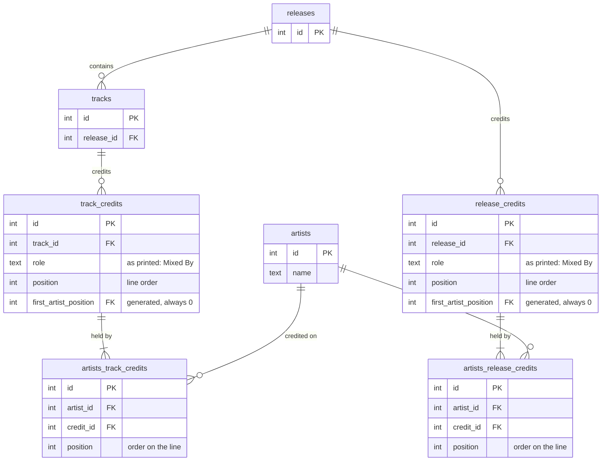

# Credits with free-text roles

> **Status: in design.** Nothing in it is built yet.

This document changes how credits are stored. It builds on the base design ([1_introduction.md](1_introduction.md)) and replaces its credit roles: design §4.3 "Artists and credits", the credit tables in design §4.4, and the credit parts of design §7. The rest of how credits work stays the same: they're kept apart from release and track artists, and they're shown under each track and on the release page.

It also joins every list of artist names with commas, where the base design used "&": "U2 & Green Day" in design §4.3 and §7.7.

## 1. Summary

- A credit's role is free text, typed on each release or track as it's printed: "Mixed By" on one release, "Mixer" on another. The shared list of roles, `credit_roles`, goes away, and so do its pages.
- A credit is a line: one role and the artists who hold it, in order. "Engineer – Paul Barrett, Robbie Adams" is one credit with two artists.
- Four tables replace the old three: `release_credits` and `track_credits` hold the lines, and `artists_release_credits` and `artists_track_credits` hold the artists on each line.
- The database checks that every line has an artist.
- Every list of artist names is joined with commas: "U2, Green Day", not "U2 & Green Day".
- One migration replaces the old tables. It drops their credits and roles rather than carrying them over.
- One phase: the schema, the backend and the UI change together.

## 2. Why

**Roles aren't a shared list.** Each release words its credits its own way. The same job is "Mixed By" on one record and "Mixer" on another, and roles carry qualifiers: "Engineer [Assistant]", "Keyboards [Additional]". With a list the user manages (design §4.3), there are two options, and neither works:
- pick one spelling for everyone, so credits stop matching the record;
- add a row for every spelling and qualifier, until the list isn't worth managing.

**Roles are shared by people.** Credits are shown a line per role: "Engineer – Paul Barrett, Robbie Adams". Today each credit is one artist with one role. The line exists only on screen, where the UI groups credits by role, so it has no order of its own: it shows up where its first artist's credit is.

## 3. Scope

In scope:
- free-text roles on release and track credits;
- several artists per role, in order, and the lines in order;
- the database checking that every line has an artist;
- role suggestions in the editor, from roles already in use;
- commas between artist names everywhere, on credit lines and off them.

Out of scope:
- **A managed list of roles.** Suggestions help reuse a spelling that's already in use, but nothing enforces one.
- **Release credits for some of its tracks.** Discogs can limit a release credit to some tracks: "Producer – Steve Lillywhite (tracks: A2, A5)". In Slunk, such a credit is entered on each of those tracks.
- **Names as credited.** Discogs can show an artist under another name on one credit (an "artist name variation"). Here every name on a line is an artist, shown with the artist's own name, so every credit appears on that artist's page.
- **Role and qualifier as separate fields.** "Engineer [Assistant]" is one role, typed as printed.

## 4. Data model

### 4.1 Example

Two tracks from the US vinyl of U2's "Achtung Baby" (Island Records, 314-510 347-1):

```
A2  Even Better Than The Real Thing
      Engineer – Paul Barrett, Robbie Adams
      Mixed By – Steve Lillywhite
A5  Who's Gonna Ride Your Wild Horses
      Engineer – Robbie Adams
      Mixed By – Robbie Adams
      Producer – Steve Lillywhite
```

They're stored like this (ids made up):

`track_credits`

| id | track | role | position |
|---|---|---|---|
| 1 | A2 | Engineer | 0 |
| 2 | A2 | Mixed By | 1 |
| 3 | A5 | Engineer | 0 |
| 4 | A5 | Mixed By | 1 |
| 5 | A5 | Producer | 2 |

`artists_track_credits`

| credit | artist | position |
|---|---|---|
| 1 | Paul Barrett | 0 |
| 1 | Robbie Adams | 1 |
| 2 | Steve Lillywhite | 0 |
| 3 | Robbie Adams | 0 |
| 4 | Robbie Adams | 0 |
| 5 | Steve Lillywhite | 0 |

Robbie Adams is on two lines of A5. A record that credits the same job as "Mixer" stores "Mixer".

### 4.2 Design decisions

**Roles are free text.**
- `role` is stored as typed, so it reads like the record: "Mixed By", "Engineer [Assistant]".
- It's non-empty, with no leading or trailing spaces: the same CHECK as other text (design Appendix A).
- It compares ignoring case (`COLLATE NOCASE`), like text tag values, so "Mixed By" and "Mixed by" are the same role on a release.
- A qualifier is part of the role. "Engineer" and "Engineer [Assistant]" are two roles, so they're two lines.
- Roles are shown as stored. The UI stops capitalizing them, which it only did because the starter roles were lowercase.
- As before, nothing depends on a role's text. Performers have their own tables (design §4.3), so no role decides who performs a track.

**A credit is a line.**
- `release_credits` and `track_credits` hold the lines: the release or track, the role, and `position`, the line's order.
- `artists_release_credits` and `artists_track_credits` hold each line's artists, with `position`, their order on the line, numbered from 0.
- A role appears once per release or track. A second "Engineer" line would be the first one split in two.
- An artist appears once per line. They can still hold several roles on the same release or track (Robbie Adams engineered and mixed A5), and still be one of its performers.
- A line has at least one artist, and the database checks it (below).

**The database checks that every line has an artist.** A line is inserted before its artists, so a CHECK or a trigger on the line can't see them. A deferred foreign key can:
- Each line table has `first_artist_position`, a generated column that's always 0.
- A foreign key from the line's `(id, first_artist_position)` to its artist table's `(credit_id, position)` says the line has an artist at position 0.
- The key is `DEFERRABLE INITIALLY DEFERRED`, so SQLite checks it at commit, once the line and its artists are both in. A transaction that leaves a line with no artists fails with `FOREIGN KEY constraint failed`, whether it inserted the line without any or removed the last one.
- So a line's artists are numbered from 0, and `(credit_id, position)` is unique, as the key's parent must be.
- Credits are saved inside a transaction. Outside one, each statement commits on its own, so a new line would fail before its artists are in. The catalog context already saves them in one.
- The catalog context checks for lines with no artists first, with a clear message. The database's generic error is a backstop.
- Migrations run with foreign keys off, and the runner's `foreign_key_check` (design §5.2) still catches a line left with no artists.
- `pragma_table_info` doesn't list generated columns, so `rebuildTable()` leaves `first_artist_position` out of its copy, and the new definition creates it again.

This works on the SQLite that better-sqlite3 bundles (3.53).

**One pair of tables per owner.** Release and track credits keep separate tables, as release and track artists, file links and tag values do.
- The line tables keep their names, `release_credits` and `track_credits`, since tables that hold more than a link are named after their owner (design §4.2 Naming).
- The artist tables are join tables, so they name both sides in alphabetical order: `artists_release_credits`, `artists_track_credits`.

**Delete rules** (design §4.2):
- Deleting a release or track deletes its lines (CASCADE). Deleting a line deletes its artist links (CASCADE).
- Removing a line's last artist fails at commit, unless the line is deleted too.
- A credited artist can't be deleted (RESTRICT), as before.
- Roles no longer block any delete, since they aren't rows.

### 4.3 Schema



`credit_roles` is dropped, and so are the old `release_credits` and `track_credits`, which held one artist and a `role_id` per row.

#### Constraints & indexes

Every table is `STRICT`.

**release_credits** / **track_credits**
- `role` is `COLLATE NOCASE`, non-empty and trimmed: `role <> '' AND role = trim(role)`
- `(release_id, role)` / `(track_id, role)` unique. It also indexes the foreign key, and returns the lines of a page of releases or tracks at once.
- release/track side ON DELETE CASCADE
- `position >= 0`
- `first_artist_position` is `GENERATED ALWAYS AS (0) VIRTUAL`
- `(id, first_artist_position)` references `artists_release_credits (credit_id, position)` / `artists_track_credits (credit_id, position)`, `DEFERRABLE INITIALLY DEFERRED`

**artists_release_credits** / **artists_track_credits**
- `(credit_id, artist_id)` unique · `(credit_id, position)` unique · index `artist_id`
- `credit_id` ON DELETE CASCADE · `artist_id` ON DELETE RESTRICT
- `position >= 0`

`role` has no index of its own. Role suggestions search for part of the text, which scans either way, like the search on lists (design §7.3).

## 5. Migration

One migration, `<timestamp>_free_text_credit_roles`. It doesn't carry the old credits over: the roles used so far aren't worth keeping, so they're dropped with the credits that use them. The runner's backup (design §5.2) still holds them.

`up`:
1. Drops the old `release_credits` and `track_credits`, then `credit_roles` with its starter rows.
2. Creates the four new tables.

`down` drops the four tables and recreates the old three as the baseline defined them: empty, except for the starter rows of `credit_roles`. Credits entered since `up` are lost.

The runner's backup and `foreign_key_check` (design §5.2) apply as usual.

## 6. Backend

**Catalog context.**
- A credit is `{ role, artistIds }`.
- Saving a release's credits still replaces them and its tracks' credits, and the track form still saves the track's own.
- The role is trimmed before it's saved, like names.
- An artist given twice on a line is kept once, as a tag value given twice is.
- A save fails with a clear message when a role is empty, when a line has no artists, or when two lines share a role, ignoring case.

**Repositories.**
- The credits repository reads and writes lines with their artists, numbering each line's artists from 0.
- An artist's credits are a row per line the artist is on, with the line's role.
- `credit_roles` leaves the lists repository, which keeps release formats and media.

**GraphQL.**

```graphql
"A credit line: a role, as printed, and the artists who hold it, in order."
type Credit {
  role: String!
  artists: [Artist!]!
}

"A credit line the artist is on."
type ArtistCredit {
  role: String!
  release: Release!
  "Null for a credit on the release itself"
  track: Track
}

input CreditInput {
  role: String!
  "At least one, in display order"
  artistIds: [ID!]!
}

extend type Query {
  "Roles in use on releases and tracks, for suggestions: the first 20 containing `q`, ignoring case, the most used first. Each spelling is its own suggestion, so \"Mixed By\" and \"Mixed by\" are both offered."
  creditRoles(q: String): [String!]!
}
```

- `CreditRole` and the `credit_roles` value of `ListKind` are removed, so `listItems` covers release formats and media.
- `ArtistCounts.credits` counts the lines the artist is on.

## 7. Frontend

**Credits editor.** It's used by the release's Credits tab (design §7.6), the track form (design §7.8) and the import's credits step (design §7.9). It has a row per line: the role, then its artists, then buttons to reorder or remove the line.

```
Credits
┌─────────────────────────────────────────────────────────────────────┐
│ Engineer    Paul Barrett ×  Robbie Adams ×   [ Add artist ]   ↑ ↓ ✕ │
│ Mixed By    Steve Lillywhite ×               [ Add artist ]   ↑ ↓ ✕ │
└─────────────────────────────────────────────────────────────────────┘
[ Role             ]  [ Artist           ]  [ Add credit ]
```

- The role is a text field with suggestions from `creditRoles`, like a text tag's value. Whatever is typed is the role, and a suggestion only fills it in. Every spelling in use is offered, since releases spell the same role differently.
- A line's role can be edited in place.
- A line's artists are added with the artist picker, which can still create an artist. They can be removed and reordered. An artist already on the line isn't added again.
- "Add credit" takes a role and a first artist. If a line already has that role, ignoring case, the artist joins that line instead.
- Two lines with the same role, or a line with no artists, are marked, and the form can't be saved until they're fixed.

**Display.** A line per credit, in order, such as "Engineer – Paul Barrett, Robbie Adams". Lines show under each track and in the release page's Credits (design §7.6), and on the track page (design §7.8). The role is shown as stored, and the artists are joined with commas, like every list of names (below).

**Names joined with commas.** Every list of artists is joined with commas: "U2, Green Day – The Saints Are Coming", not "U2 & Green Day". That covers release artists, track artists, features and performers as well as credit lines, wherever they're shown. Labels are already joined this way. An "&" that's part of an artist's name, as in "Simon & Garfunkel", stays.

**Artist page, Credits tab** (design §7.7). Same columns: role, release, track, released. Rows are grouped by role, ignoring case, so "Mixed By" and "Mixed by" share a group while "Mixer" has its own.

**Removed.** The credit roles pages (`/credit-roles` and its CRUD routes, design §7.4 and §7.8), and their sidebar entry. The sidebar's Lists group keeps Tags, Release formats and Release media.

## 8. Phases

**Phase 0 — Credit lines**

One vertical slice, because the old UI can't work on the new tables:
- the migration (§5);
- repositories, catalog context and GraphQL (§6), with codegen run in both projects;
- the credits editor, the credit lines, the track page and the artist Credits tab, and removing the credit roles pages (§7);
- commas between artist names everywhere (§7);
- docs: `reference/database.md`, `development/backend.md` and `development/frontend.md` describe credits and the joined names as built.

*Exit:* tracks A2 and A5 of "Achtung Baby" can be entered and shown as in §4.1, with each role exactly as typed. The database refuses a line with no artists. No list of artists shows "&" between names. The migration applies and rolls back, both on a fresh database and on one with old credits.

## 9. Alternatives considered

- **A free-text role on each credit row, one artist per row.** The smallest change: replace `role_id` with `role`. But every artist's row repeats the role, so a typo on one row splits the line in two, and changing a line's role means changing every row. The line would still exist only on screen, with no order of its own.
- **One credits table for releases and tracks.** `release_id` and `track_id` would both be nullable, with a CHECK that exactly one is set, and a single artist table. That's two tables instead of four, and credit ids would be unique across releases and tracks. It's rejected for consistency: every other link that releases and tracks both have uses a table per owner, and the code already maps each owner to its table.
- **A trigger instead of the deferred key.** A trigger can refuse removing a line's last artist, but not inserting a line without one, since its artists come after it. The deferred key catches both.
- **Keep `credit_roles`, and add the role as printed.** Roles would be stored twice, and the user would still have to manage the list that isn't working.
