# Alternate names and titles

> **Status: being built.**

This document gives artists and labels alternate names, and releases, discs and tracks alternate titles, each with its language. It also lets every place an artist is named on a release or track say which name was printed there. It builds on the base design ([1_introduction.md](1_introduction.md)) and on credit lines ([2_credits.md](2_credits.md)), and adds two things they left out: real names (design §7.7, "Not shown") and names as credited (2_credits.md §3).

## 1. Summary

- An artist keeps its main name and gets any number of **alternate names**: other spellings ("ALIKA"), initials ("R. Fukui"), names in other scripts ("福居良") and real names ("Alika Milova"). Each one can have a language. Labels get alternate names too.
- Every **artist link** (a release artist, a track artist or feature, an artist on a credit line) can be **credited as** one of the artist's names: "ALIKA" on "virmalised". The database checks that the name belongs to that artist.
- Releases, discs and tracks keep their main title and get **alternate titles**. Each has a language and says whether it's printed on the release: "Scenery" with "シーナリィ" (Japanese, printed), or "virmalised" with "Northern Lights" (English, added in Slunk).
- Any name or title can carry a BCP 47 language tag (`ja`, `ja-Latn`, `zh-Hant`). The UI uses it to label the name, to set `lang` so the right glyphs are drawn, and to pair names and titles in the same language.
- **No "=" and no "\*".** The main names and title come first. Each alternate title gets its own quieter line underneath, with the artists' names in that title's language. Credited names are shown as printed, and hovering one shows the artist's main name.
- Search finds artists, labels, releases and tracks by any of their names or titles.
- Four phases: alternate names, credited names, alternate titles, then import suggestions.

## 2. Why

**One name per artist doesn't match the records.** Alika is "Alika" on the self-titled album and "ALIKA" on "virmalised" (2024). Today Slunk has two ways to record that, and neither is right:
- show "Alika" on both, which isn't what's printed;
- make "ALIKA" a second artist, which splits Alika's releases across two pages.

**Some releases print everything twice.** Ryo Fukui's "Scenery" (Nadja, PA-7148) prints its artists and titles in English and in Japanese. Discogs packs both into one field, joined with "=":
- the title is the string "Scenery = シーナリィ", and each track is like "Autumn Leaves = 枯葉";
- Ryo Fukui is credited twice, as "Ryo Fukui" and as "福居良".

That's display baked into the data:
- Neither half can be searched, sorted, styled or marked with its language on its own.
- "=" also appears in real titles, like Big Audio Dynamite's "E=MC²", so a string can't reliably be split back.
- Discogs marks a name variation with "\*" ("ALIKA\*"), and the reader has to hover to learn whose name it is.

**Real names have nowhere to go.** The base design leaves real names and aliases out (design §7.7). Discogs records Alika's real name as Alika Milova.

**Search misses them.** Searching for 福居良 or シーナリィ finds nothing, because neither is stored.

## 3. Scope

In scope:
- alternate names for artists and labels, in order, each with an optional language and note; real names among an artist's names;
- the name each artist link was credited with: release artists, track artists and features, and artists on credit lines;
- alternate titles for releases, discs and tracks, in order, each with an optional language and whether it's printed;
- the language of each main name and title;
- showing all of it without "=" or "\*", with `lang` and `dir` set on every name and title;
- search by any name or title;
- import suggestions that use them.

Out of scope:
- **Aliases as separate artists.** On Discogs, a pseudonym with its own discography is its own artist, linked to the other as an alias: Alika also has an "Alika Milova" profile. In Slunk, a name is either one of an artist's alternate names or a separate artist. Links between artists, like aliases and group members, need their own design.
- **Merging artists.** Merging two artists, keeping one's name as an alternate name of the other, would build on this design, but it's a separate feature.
- **Sort names and readings.** Lists keep sorting by the main name or title. "Beatles, The", or a Japanese title sorted by its reading, needs a sort name, which isn't a name to show.
- **Credited names for labels.** Each release picks the label itself, as now.
- **Alternate names for formats, media, tags, tag values and credit roles.** They're the user's own vocabulary, named once. A role is already typed as printed (2_credits.md).
- **A display language setting.** Showing English titles first everywhere would leave lists sorted by titles they don't show (§10).
- **Search that folds non-ASCII case, accents or kana width.** SQLite's `like` and `NOCASE` fold ASCII only. "alika" finds "ALIKA", but "алика" doesn't find "Алика", and "bjork" doesn't find "Björk". Adding "Bjork" as an alternate name is the workaround.
- **Join phrases.** Names stay joined with commas (2_credits.md §7). Only the "=" goes.
- **Works.** The original title of a composition ("Les Feuilles mortes", for "Autumn Leaves") can be an alternate title that isn't printed, but Slunk doesn't model works.

## 4. Data model

### 4.1 Examples

**Alika.** The real name is Alika Milova. "virmalised", Estonian for the northern lights, credits the artist as "ALIKA". Ids are made up.

`artist_alternate_names`

| id | artist | name | language | real_name | position |
|---|---|---|---|---|---|
| 1 | Alika | Alika Milova | | 1 | 0 |
| 2 | Alika | ALIKA | | 0 | 1 |

`artists_releases`

| release | artist | credited_name_id | position |
|---|---|---|---|
| Alika | Alika | | 0 |
| virmalised | Alika | 2 (ALIKA) | 0 |

`releases` and `release_alternate_titles`

| release | title | title_language | alternate title | language | printed |
|---|---|---|---|---|---|
| virmalised | virmalised | et | Northern Lights | en | 0 |

**"Scenery"** (Nadja, PA-7148), entered with the English names and titles as the main ones, as the sleeve and Discogs list them first:

`artist_alternate_names`

| id | artist | name | language |
|---|---|---|---|
| 3 | Ryo Fukui | 福居良 | ja |
| 4 | Ryo Fukui | R. Fukui | |
| 5 | Ryo Fukui Trio | 福居良トリオ | ja |
| 6 | Jimmy Van Heusen | J. Van Heusen | |
| 7 | Ann Ronell | A. Ronnell | |
| 8 | Masataka Ito | いとう・まさたか | ja |
| 9 | Teruo Isono | いソノてルヲ | ja |

The release is titled "Scenery", with `title_language` `en`, and one alternate title, "シーナリィ" (`ja`, printed). Its release artists are Ryo Fukui and Ryo Fukui Trio, each once, with no credited name. Four of its six tracks:

| # | title | alternate title (`ja`, printed) | Written-By, credited as |
|---|---|---|---|
| 1 | It Could Happen To You | イット・クッド・ハプン・トゥ・ユー | Jimmy Van Heusen as J. Van Heusen (6) |
| 4 | Willow Weep For Me | ウィロウ・ウィープ・フォー・ミー | Ann Ronell as A. Ronnell (7) |
| 5 | Autumn Leaves | 枯葉 | Joseph Kosma as J. Kosma |
| 6 | Scenery | シーナリィ | Ryo Fukui as R. Fukui (4) |

- The tracks' `title_language` is NULL, so they take the release's: `en`.
- "A. Ronnell" is misspelt on the record. It's kept as printed, and it's still linked to Ann Ronell.
- The release's Liner Notes line credits Masataka Ito as "いとう・まさたか" (8) and Teruo Isono as "いソノてルヲ" (9).
- Ryo Fukui is a release artist once, not twice. The Japanese line under the title gets "福居良" from Ryo Fukui's alternate names (§7.2).

### 4.2 Design decisions

**Main and alternate.**
- Each artist and label keeps its one `name`, and each release, disc and track its one `title`. That's the main one:
  - lists sort by it;
  - it's what the breadcrumb and every page show first;
  - nothing that uses it today changes.
- Alternate names and titles are rows in their own tables, in `position` order. Each owner has its own table (design §4.2 Naming; 2_credits.md §4.2, "One pair of tables per owner").
- The user chooses which name or title is the main one. It's usually what's printed most prominently, or the original language. Lists sort by it, so a library sorted in Latin order keeps Latin names and titles as the main ones, as Discogs does.

**Languages.**
- Any name or title can have a language, as a BCP 47 tag: `en`, `ja`, `ja-Latn` (Japanese in Latin script: romaji), `zh-Hant`, `sr-Cyrl`. NULL means unknown.
- A main name or title keeps its language in a column next to it: `artists.name_language`, `labels.name_language`, `releases.title_language`, `tracks.title_language`, `release_disc_titles.language`.
- For a track or a disc title, NULL means the release's language. Titles on a release almost always share one, so a track only sets its own when it's in another language, as on a compilation. For an alternate title, NULL just means unknown.
- Tags are stored in canonical form: the backend runs them through `Intl.getCanonicalLocales`, so `JA-latn` becomes `ja-Latn`. It refuses:
  - a malformed tag, like `ja_JP`;
  - a primary subtag that isn't 2 or 3 letters. "japanese" is well formed, but it isn't a language;
  - `und`, which means unknown. That's what NULL is for.
- The database checks a tag's shape (§4.3). Whether it names a real language is left to the app.
- Tags rather than a list the user manages, like formats:
  - the browser can name any tag (`Intl.DisplayNames` calls `ja-Latn` "Japanese (Latin)");
  - the UI needs the tag itself for `lang`.
- Languages match exactly: `ja-Latn` isn't `ja`, and `zh-Hant` isn't `zh-Hans`. The language picker offers the tags already in use first, so a language keeps one tag.

**Artists' alternate names.**
- `artist_alternate_names` holds the artist, the name as written, its language, `real_name`, a `note`, and `position`.
- An alternate name is any name the artist is known or credited by:
  - another spelling or capitalization: "ALIKA";
  - initials: "R. Fukui", "J. Van Heusen";
  - a misprint: "A. Ronnell";
  - the name in another script: "福居良";
  - a search hint: "Bjork".
- `real_name` (0 or 1) marks a real name: a legal or birth name.
  - An artist can have several: a birth name and a married name, or a real name in two scripts.
  - A group has none.
- `note` is free text, like a file link's note: "birth name", "misprint", "until 1998".
- Names compare exactly, case included (`BINARY`), unlike Slunk's other names. "ALIKA" and "Alika" differ only by case, and that difference is the point. So `(artist_id, name)` is unique without `NOCASE`.
- An alternate name can't be the same as the artist's main name, except a real name: an artist who performs under their real name can still record it as one.
  - The app checks this rule, not a trigger. SQLite runs triggers per statement, not at commit, and promoting a name (§6) has the two equal for a moment.

**Labels' alternate names.** `label_alternate_names` works the same, without `real_name`. It holds names in other scripts ("トリオレコード" for Trio Records) and former names. A release still picks the label itself, so labels have no credited names.

**Credited names.**
- An **artist link** is a row that names an artist on a release or track: `artists_releases`, `artists_tracks` (including features), `artists_release_credits` and `artists_track_credits`.
- Each one gets `credited_name_id`, the alternate name printed there. NULL means the artist's main name, which is what every link shows today.
- The credited name must be one of that artist's names. A foreign key goes from the link's `(artist_id, credited_name_id)` to `artist_alternate_names (artist_id, id)`.
  - When `credited_name_id` is NULL, SQLite doesn't check the key.
  - Otherwise the key refuses three things: crediting an artist with another artist's name, moving a credited name to another artist, and changing a link's artist while keeping the old artist's name.
- A credited name can't be deleted while a link uses it (RESTRICT).
  - `SET NULL` won't work: `artist_id` is part of the key, so it would be set to NULL too.
  - When the user removes a name that's in use, the app clears it from the links first (§6).
- An artist still appears once per release, track or credit line. Discogs credits Ryo Fukui twice on "Scenery" ("Ryo Fukui = 福居良"). Slunk credits the artist once, and the Japanese line shows the Japanese name (§7.2).
- A link with no credited name shows the artist's current main name, so renaming an artist renames it on those links. §6 describes how a rename can keep the old name instead.
- Credited names point to rows, while credit roles are free text (2_credits.md). Names need to be rows anyway:
  - real names and names in other scripts belong to the artist, whether or not a release prints them;
  - search and the artist page need one list of names;
  - fixing a misspelt credited name fixes it on every release at once, instead of a hunt through each one.

**Alternate titles.**
- `release_alternate_titles`, `track_alternate_titles` and `release_disc_alternate_titles` each hold the title, its language, `printed`, and `position`.
- `printed` (0 or 1, default 1) says whether the title is on the release as published: on the sleeve, or in a digital release's own metadata.
  - 0 is for a title added in Slunk: a translation ("Northern Lights") or a romanization ("Kaze no Tani no Naushika").
  - Slunk keeps everything else as printed (labels, catalog numbers, roles), so the UI shows the difference.
- A disc's alternate titles belong to its title: `disc_title_id` references `release_disc_titles`.
  - So a disc needs a main title before it can have an alternate one.
  - When the disc's last track leaves it, the disc title triggers delete its title, and CASCADE deletes its alternate titles.
- Titles compare exactly. `(owner, title)` is unique, and an alternate title can't be the same as the main title (the app checks this, as for names).

**Text.**
- Names and titles are trimmed and non-empty, as everywhere (design Appendix A).
- They're also normalized to Unicode NFC before they're saved. The same text can be stored in two forms: "é" as one code point, or as "e" followed by an accent. A name typed on one machine and one read from a file's tags on another can differ that way. They look the same, but they don't compare equal, so neither would find the other.
- NFC, not NFKC. NFKC also rewrites what's printed: "E=MC²" becomes "E=MC2", and half-width "ｼｰﾅﾘｨ" becomes "シーナリィ".
- Paths aren't normalized. They have to match the disk byte for byte.
- The app's trim also removes Unicode spaces, like the ideographic space "　". SQLite's `trim()` in the CHECK only removes ASCII spaces, so the database's check is the looser of the two.

**Delete rules** (design §4.2):
- Deleting an artist, label, release, track or disc title deletes its alternate names or titles (CASCADE). An artist that's still linked can't be deleted, so by the time it is, no link uses its names.
- Deleting an alternate name that a link is credited with fails (RESTRICT).
- Deleting a release or track deletes its artist links, as before, with their credited names. The alternate names stay with the artist.

### 4.3 Schema

Only the columns this design adds, and the ones it relies on, are shown.

```mermaid
erDiagram
    artists {
        int id PK
        text name "main name"
        text name_language "nullable"
    }
    artist_alternate_names {
        int id PK
        int artist_id FK
        text name "as written: ALIKA"
        text language "nullable: ja"
        int real_name "0 or 1"
        text note "nullable"
        int position
    }
    artists_releases {
        int id PK
        int artist_id FK
        int release_id FK
        int credited_name_id FK "nullable: the main name"
    }
    artists_tracks {
        int id PK
        int artist_id FK
        int track_id FK
        int credited_name_id FK "nullable"
    }
    artists_release_credits {
        int id PK
        int artist_id FK
        int credit_id FK
        int credited_name_id FK "nullable"
    }
    artists_track_credits {
        int id PK
        int artist_id FK
        int credit_id FK
        int credited_name_id FK "nullable"
    }
    labels {
        int id PK
        text name
        text name_language "nullable"
    }
    label_alternate_names {
        int id PK
        int label_id FK
        text name
        text language "nullable"
        text note "nullable"
        int position
    }
    releases {
        int id PK
        text title
        text title_language "nullable"
    }
    release_alternate_titles {
        int id PK
        int release_id FK
        text title
        text language "nullable"
        int printed "0 or 1, default 1"
        int position
    }
    tracks {
        int id PK
        int release_id FK
        text title
        text title_language "nullable: the release's"
    }
    track_alternate_titles {
        int id PK
        int track_id FK
        text title
        text language "nullable"
        int printed "0 or 1, default 1"
        int position
    }
    release_disc_titles {
        int id PK
        int release_id FK
        int cd_number
        text title
        text language "nullable: the release's"
    }
    release_disc_alternate_titles {
        int id PK
        int disc_title_id FK
        text title
        text language "nullable"
        int printed "0 or 1, default 1"
        int position
    }

    artists ||--o{ artist_alternate_names : "also named"
    artists ||--o{ artists_releases : "artist of"
    artists ||--o{ artists_tracks : performs
    artists ||--o{ artists_release_credits : "credited on"
    artists ||--o{ artists_track_credits : "credited on"
    artist_alternate_names |o--o{ artists_releases : "credited as"
    artist_alternate_names |o--o{ artists_tracks : "credited as"
    artist_alternate_names |o--o{ artists_release_credits : "credited as"
    artist_alternate_names |o--o{ artists_track_credits : "credited as"
    labels ||--o{ label_alternate_names : "also named"
    releases ||--o{ release_alternate_titles : "also titled"
    releases ||--o{ tracks : contains
    tracks ||--o{ track_alternate_titles : "also titled"
    releases ||--o{ release_disc_titles : "disc titled"
    release_disc_titles ||--o{ release_disc_alternate_titles : "also titled"
```



#### Constraints & indexes

Every new table is `STRICT`.

**Language columns:** `artists.name_language`, `labels.name_language`, `releases.title_language`, `tracks.title_language`, `release_disc_titles.language`, and `language` on the five new tables.
- NULL, or a tag in canonical shape: 2 or 3 lowercase letters, then only letters, digits and single hyphens, not ending in a hyphen.
- Not `und`, and not starting with `und-`.
- The migrations share one helper for this CHECK, as they do for trimmed text.

**artist_alternate_names**
- `name` is non-empty and trimmed, and compares exactly (`BINARY`)
- `(artist_id, name)` unique. It also indexes the foreign key.
- `(artist_id, id)` unique, as the parent key of credited names
- index `name COLLATE NOCASE`, for the import's lookup by name (§6)
- `artist_id` ON DELETE CASCADE
- `real_name` in (0, 1), default 0 · `note` NULL or non-empty and trimmed · `position >= 0`

**label_alternate_names**
- `name` is non-empty and trimmed, and compares exactly
- `(label_id, name)` unique, which indexes the foreign key
- `label_id` ON DELETE CASCADE
- `note` NULL or non-empty and trimmed · `position >= 0`

**artists_releases** / **artists_tracks** / **artists_release_credits** / **artists_track_credits**
- `credited_name_id` is nullable
- `(artist_id, credited_name_id)` references `artist_alternate_names (artist_id, id)`, ON DELETE RESTRICT
- index `(artist_id, credited_name_id)` replaces index `artist_id`
- everything else stays as it is

**release_alternate_titles** / **track_alternate_titles** / **release_disc_alternate_titles**
- `title` is non-empty and trimmed, and compares exactly
- `(release_id, title)` / `(track_id, title)` / `(disc_title_id, title)` unique, which indexes the foreign key
- `release_id` / `track_id` / `disc_title_id` ON DELETE CASCADE
- `printed` in (0, 1), default 1 · `position >= 0`

**Left to the app:**
- an alternate name or title the same as the main one (allowed only for real names);
- a tag's canonical form, beyond its shape;
- NFC normalization;
- everything about how names and titles are shown (§7).

## 5. Migrations

Three migrations, one for each phase that changes the schema.

1. **`<timestamp>_add_alternate_names`** (phase 0)
   - Creates `artist_alternate_names` and `label_alternate_names`.
   - Adds `artists.name_language` and `labels.name_language` with `ALTER TABLE … ADD COLUMN`, so neither table is rebuilt. An added column can have a CHECK, and since SQLite 3.37 existing rows are checked against it too.
   - `down` drops the tables, then the columns. `DROP COLUMN` works on a column whose only CHECK is its own.
2. **`<timestamp>_add_credited_names`** (phase 1)
   - Rebuilds the four artist link tables with `rebuildTable()` (design §5.3 and Appendix B). `ADD COLUMN` can't add a foreign key over two columns.
   - Every existing link gets a NULL `credited_name_id`, so it's credited with the main name, as it's shown now.
   - `(artist_id, credited_name_id)` replaces the `artist_id` index.
   - `artists_release_credits` and `artists_track_credits` are the parents of the credit lines' deferred keys (2_credits.md §4.2), so their `(credit_id, position)` unique index has to be recreated with them. The runner's `foreign_key_check` then confirms that every line still has its first artist.
   - `down` rebuilds the four tables without the column. Credited names are lost, and the alternate names stay.
3. **`<timestamp>_add_alternate_titles`** (phase 2)
   - Creates `release_alternate_titles`, `track_alternate_titles` and `release_disc_alternate_titles`.
   - Adds `releases.title_language`, `tracks.title_language` and `release_disc_titles.language`.
   - `down` drops them.

The runner's backup and `foreign_key_check` (design §5.2) apply as usual.

## 6. Backend

**Languages.**
- A language is given as a tag, and blank means none. The backend stores it in canonical form and refuses an invalid one, as described in §4.2.
- `languages` lists the tags in use on names and titles, the most used first, for the language picker.

**Alternate names.**
- An artist's or label's alternate names are saved with it, as a list:
  - a row with an id updates that name;
  - a row without one adds a name;
  - a name left out is removed.

  If the list itself is left out, the names stay as they are.
- A save is refused with a message when two names are the same, or when a name other than a real name is the same as the main name.
- Removing a name that links are credited with credits those links with the main name instead. The form warns about this before saving.
- Renaming an alternate name renames it on every link credited with it. That's how a misspelt credit gets fixed.

**Renaming an artist.**
- A new main name shows on every link without a credited name.
- With `keepOldName`, those links are credited with the old name instead. The old name is added to the alternate names if it isn't one already.
  - The form asks when the artist has such links. A typo fix doesn't want this; a change of main name does.
- Renaming an artist to one of its alternate names promotes that name:
  - links credited with it lose their credited name, since the main name now reads the same;
  - the alternate name is removed, unless it's a real name.
- With `keepOldName` too, the two names swap, and every link still shows what it showed before.

**Credited names.**
- An artist link is given as `{ artistId, creditedAs }`, where `creditedAs` is the name as printed. It's resolved against the artist's names:
  - blank, or the same as the main name: no credited name;
  - the same as one of the artist's alternate names: that name;
  - anything else is added as a new alternate name.
- "The same" means exactly, case included: "ALIKA" isn't "Alika".
- A name added this way gets a language only when its script gives the language away: kana means `ja`, and Hangul means `ko`. Han characters alone could be Chinese or Japanese, and Cyrillic could be several languages, so those get none.
- An artist given twice on a line is kept once, as now, with the first credited name.
- Who performs a track (design §4.3) keeps its fallback: a track with no artists of its own takes the release's artist links, with their credited names.

**Alternate titles.**
- Alternate titles are saved with their owner, and replace its old ones. Left out, they stay as they are.
  - A release's are saved with its details: `createRelease`, `updateRelease`.
  - A track's: with `setReleaseTracks`, `createTrack` and `updateTrack`.
  - A disc's: with its disc title, in `setReleaseTracks`.
- A save is refused with a message when two alternate titles are the same, when one is the same as the main title, or when a disc has alternate titles but no main title.

**Search.**
- `q` on artists and labels matches the main name or any alternate name. On releases and tracks, it matches the main title or any alternate title. It still scans the table, as search does today (design §7.3).
- `releasesTitled`, the import's check for duplicates, matches alternate titles too, so importing "シーナリィ" finds "Scenery".
- Pickers search the same way.

**Text.** The trim that the catalog and tagging contexts apply to all text now also normalizes it to NFC. Paths, which belong to the media context, aren't normalized. Existing rows aren't rewritten: they're normalized the next time they're saved.

**Loading.** A page's alternate names and titles are loaded in one query per kind, by DataLoaders, like other related rows (design §7.3).

**GraphQL.** New types:

```graphql
"A name an artist goes by, besides its main one."
type ArtistName {
  id: ID!
  name: String!
  "A BCP 47 tag: ja, ja-Latn, zh-Hant. Null when unknown."
  language: String
  "A legal or birth name"
  realName: Boolean!
  note: String
  "Artist links credited with it"
  uses: Int!
}

"A name a label goes by, besides its main one. It has no id: nothing refers to it."
type LabelName {
  name: String!
  language: String
  note: String
}

"A title besides the main one. It has no id: it's part of its release, disc or track."
type AlternateTitle {
  title: String!
  language: String
  "On the release as published. False for a title added in Slunk, like a translation."
  printed: Boolean!
}

"An artist as credited on a release, a track or a credit line. It has no id, so the cache keeps it inside its parent."
type CreditedArtist {
  artist: Artist!
  "The name printed, when it isn't the artist's main name"
  creditedAs: ArtistName
}

input CreditedArtistInput {
  artistId: ID!
  "As printed. Blank, or the main name, means the main name. A name the artist doesn't have yet is added to its alternate names."
  creditedAs: String
}

input ArtistNameInput {
  "One of the artist's names. Without an id, the name is added."
  id: ID
  name: String!
  language: String
  realName: Boolean! = false
  note: String
}

input LabelNameInput {
  name: String!
  language: String
  note: String
}

input AlternateTitleInput {
  title: String!
  language: String
  printed: Boolean! = true
}

extend type Query {
  "Language tags in use on names and titles, the most used first."
  languages: [String!]!
}
```

> Changed during implementation, see [Appendix B](#appendix-b-artists-count-the-links-that-show-the-main-name).

Changed types:
- `Artist`: `nameLanguage`, `alternateNames: [ArtistName!]!`.
- `Label`: `nameLanguage`, `alternateNames: [LabelName!]!`.
- `Release`: `titleLanguage` ("also its discs' and tracks', unless they set their own"), `alternateTitles`. `artists` becomes `[CreditedArtist!]!`.
- `Track`: `titleLanguage` ("null: the release's"), `alternateTitles`. `artists`, `features` and `performers` become `[CreditedArtist!]!`.
- `DiscTitle`: `language`, `alternateTitles`.
- `Credit.artists` becomes `[CreditedArtist!]!`. `ArtistCredit` gets `creditedAs: ArtistName`.

Changed inputs:
- `ArtistInput`: `nameLanguage`, `alternateNames: [ArtistNameInput!]` (left out: unchanged), `keepOldName: Boolean! = false`.
- `LabelInput`: `nameLanguage`, `alternateNames: [LabelNameInput!]` (left out: unchanged).
- `ReleaseInput`: `artistIds` becomes `artists: [CreditedArtistInput!]!`. Adds `titleLanguage` and `alternateTitles: [AlternateTitleInput!]` (left out: unchanged).
- `ReleaseTrackInput` and `TrackInput`: `artistIds` and `featureIds` become `artists` and `features: [CreditedArtistInput!]! = []`. Adds `titleLanguage` and `alternateTitles`.
- `DiscTitleInput`: `language`, `alternateTitles: [AlternateTitleInput!]! = []`.
- `CreditInput`: `artistIds` becomes `artists: [CreditedArtistInput!]!`.

## 7. Frontend

### 7.1 Showing names and titles

- Every name and title is shown with `lang` set to its language, when it's known, and with `dir="auto"`.
  - `lang` picks the glyphs. Japanese and Chinese share code points but not glyph shapes, so without `lang`, 福居良 may be drawn with Chinese shapes.
  - `dir="auto"` isolates right-to-left names, like فيروز (Fairuz), so the "–" and the commas around them stay in place.
- The main names and title come first, at full weight.
- Each alternate title gets its own line underneath, smaller and muted, in `position` order. An unprinted one is shown in italics, and a tooltip says it was added in Slunk.
- Credited names are shown as printed and link to the artist. When a credited name isn't the artist's main name, hovering it shows the main name: "Alika".
- No "=" and no "\*", anywhere.

### 7.2 An artist's name in a language

The line under the main one, for an alternate title in language L, repeats the artists before the title, each one in L:
- the artist's first name in L: the main name if its language is L, otherwise the first alternate name in L;
- if there isn't one, the name the artist is credited with, unless that name is in another language;
- otherwise, the artist's main name.

If every artist would read the same as on the main line, the artists are left out and the line shows only the title. An alternate title with no language also shows only the title.

The artists are repeated wherever the main line names them: the release heading, the track page heading, and tracklist rows on a various-artists release. Features and credit lines aren't repeated.

"Scenery", entered as in §4.1:

```
Ryo Fukui, Ryo Fukui Trio – Scenery
福居良, 福居良トリオ – シーナリィ                  ← from their ja names
```

The same release entered Japanese-first: the release artists are credited as "福居良" and "福居良トリオ", the main title is "シーナリィ" (`ja`), and the alternate title is "Scenery" (`en`). The credited names are in Japanese, so the English line falls back to the main names:

```
福居良, 福居良トリオ – シーナリィ
Ryo Fukui, Ryo Fukui Trio – Scenery
```

"virmalised". Alika has no English name, and "ALIKA" has no language, so the line would repeat "ALIKA" and shows only the title:

```
ALIKA – virmalised
Northern Lights                                  ← italics: added in Slunk
```

### 7.3 Release page

```
Releases > Scenery (912)                                     Edit  Delete
─────────────────────────────────────────────────────────────────────────
┌─────────┐  Ryo Fukui, Ryo Fukui Trio – Scenery
│  cover  │  福居良, 福居良トリオ – シーナリィ
│         │  Label:     Nadja – PA-7148
└─────────┘
 Files (2)

Tracklist                                Hide alternate titles  Hide credits
 1  It Could Happen To You
    イット・クッド・ハプン・トゥ・ユー
      Written-By – J. Van Heusen
 …
 5  Autumn Leaves
    枯葉
      Written-By – J. Kosma
 6  Scenery
    シーナリィ
      Written-By – R. Fukui

Credits
 Liner Notes – いとう・まさたか, いソノてルヲ
 …
```

- The heading shows the main line, then a line for each alternate title, as described in §7.2.
- Each track shows its alternate titles under its title. A disc heading shows its title as now ("CD 2 · Tokyo"), with each alternate title on its own line under it.
- "Hide alternate titles" hides them in the tracklist and the browser remembers the choice, like "Hide credits". It's for long tracklists that the alternate titles double in height. It doesn't affect the heading.
- Credit lines show each artist's credited name.

The track page follows the same rules: its heading, then a line for each alternate title.

### 7.4 Lists, cards and pickers

- Release and track lists show the main title, with one alternate title under it, muted and cut to one line.
  - Normally that's the first alternate title.
  - When the search matched another one, it's that one, so the row shows why it matched. The frontend finds it by searching the row's alternate titles for `q`, ignoring case.
- Artist and label lists do the same with names: a row that matched an alternate name shows it under the main name.
- Artist cells, and the artists on dashboard cards, show the credited names. The cards show only the main title.
- The artist picker offers the artist, plus one option for each alternate name that matched what was typed:

  ```
  [ alika                    ]
    Alika
    Alika · as ALIKA
    Alika · as Alika Milova (real name)
  ```

  Picking "as ALIKA" credits Alika as "ALIKA". Picking the plain artist doesn't, so a search hint like "Bjork" never ends up printed on a release by mistake.

### 7.5 Artist pages

> Changed during implementation, see [Appendix A](#appendix-a-the-releases-tab-shows-the-credited-name-in-the-title).

```
Artists > Alika (7)                                         Edit  Delete
Releases 2 · Appearances 0 · Credits 0 · Files 1
─────────────────────────────────────────────────────────────────────────
┌─────────┐  Alika
│ picture │  Real name:    Alika Milova
└─────────┘  Other names:  ALIKA

       Title                              Released
 [▣]   Alika                              2023
 [▣]   virmalised           as ALIKA      2024
```

- Under the name, "Real name" lists the real names, and "Other names" lists the rest of the alternate names, each with its language when it has one: "福居良 (Japanese)". A row with nothing in it is hidden.
- On the Releases, Appearances and Credits tabs, a row where the artist is credited under an alternate name says so: "as ALIKA".
- The label page shows its "Other names" the same way.

### 7.6 Forms

**Artist form.**

```
Name             [ Ryo Fukui                 ]  Language [ —          ▾ ]

Alternate names
┌───────────────────────────────────────────────────────────────────────┐
│ 福居良      Japanese ▾  ☐ Real name  [ note ]  3 uses  Make main ↑ ↓ ✕ │
│ R. Fukui    —        ▾  ☐ Real name  [ note ]  1 use   Make main ↑ ↓ ✕ │
└───────────────────────────────────────────────────────────────────────┘
[ Name               ]  [ Add name ]
```

- Each row shows how many links use the name, so a name created by a typo, with 0 uses, is easy to spot.
- Removing a name that's in use asks first: "ALIKA is credited on 1 release. Removing it credits that release as Alika."
- "Make main" swaps the row with the main name, language included, and turns on `keepOldName` for the save. Every link keeps showing what it showed (§6).
- Saving with a new main name, when links show the old one, asks whether to keep the old name on them (`keepOldName`).

**Label form.** A name and language, and alternate names with a language and a note.

**Release details.** A language beside the title, then the alternate titles, then each release artist with an "as" field:

```
Title            [ virmalised                ]  Language [ Estonian   ▾ ]
Alternate titles
  Northern Lights          English ▾   ☐ Printed               ↑ ↓ ✕
  [ Title            ]  [ Add title ]

Artists
  Alika     as [ ALIKA            ▾ ]                          ↑ ↓ ✕
  [ Artist           ]
```

- The "as" field is a combobox of the artist's alternate names. Whatever is typed in it is the credited name (§6).
- Changing a row's artist clears its "as". Otherwise the old artist's name would be added to the new artist.

**Tracks editor.** Each track row, and each disc heading, gets a "Titles" button that opens a popover with the language and the alternate titles. This keeps the grid as compact as it is now. Track artists and features each get the same "as" field as release artists.

**Credits editor.** An artist's chip shows its credited name. Clicking the chip opens a popover to change it.

**Language picker.** A combobox:
- the tags already in use first;
- then a search through language names, made with `Intl.DisplayNames` from the ISO 639-1 codes, plus common script variants: `ja-Latn`, `zh-Hans`, `zh-Hant`, `sr-Cyrl`, `sr-Latn`, `ko-Latn`, `ru-Latn`;
- any other tag can be typed in, and the backend checks it.

Each tag is shown by its name ("Japanese (Latin)"), with the tag itself muted.

### 7.7 Import (phase 3)

**Titles.**
- An album or title tag that contains " = ", with a space on each side, keeps the whole tag as the title. The form then offers to split it: "Scenery" as the main title, and "シーナリィ" as a printed alternate title.
- The split guesses the alternate title's language from its script, as credited names do (§6).
- A "Swap" button makes the second part the main title, for a user who wants the original language first.
- Nothing is ever split automatically, since "=" can be part of a title ("E=MC²"). A title without spaces around its "=" isn't offered a split.
- The tracks step offers the same split on each row that has one, and "Split all" splits every row.

**Artists.** A name from the tags is matched in this order:
1. an artist whose main name is exactly the tag;
2. an artist with an alternate name that's exactly the tag, credited as that name;
3. either one ignoring case, credited as the tag's own text. "ALIKA", with only "Alika" known, suggests Alika as "ALIKA". Matching it as "Alika" with no credited name would lose what's printed.

If a step finds more than one artist, none is picked, and the picker opens with the name typed in. That already happens with two artists of the same name, and alternate names make it likelier, since several artists can be "J. Smith".

An artist tag that contains " = " ("Ryo Fukui = 福居良") is matched by its first part. The other parts are offered as alternate names of the artist it matched.

## 8. Phases

Each phase is a vertical slice, with docs and seeds updated in the same change:
- `reference/database.md`, `development/backend.md` and `development/frontend.md` describe what's built;
- the seeds get the phase's part of §4.1.

**Phase 0 — Alternate names**
- The first migration in §5, which adds alternate names.
- Languages: canonical tags, the `languages` query, the language picker, and `lang` and `dir="auto"` on every name.
- Alternate names for artists and labels: the forms, the "Real name" and "Other names" rows, and search in lists and pickers.
- NFC in the trim (§6).
- *Exit:*
  - Alika's page shows "Real name: Alika Milova" and "Other names: ALIKA".
  - Searching artists for "福居良" lists Ryo Fukui, and shows the name that matched.
  - Adding "ALIKA" twice is refused, and so is adding "Alika", the main name.
  - The language "JA-latn" is saved as `ja-Latn`, and `ja_JP` is refused.
  - The migration applies and rolls back on a fresh database.

**Phase 1 — Credited names**
- The second migration in §5, which adds credited names.
- `CreditedArtist` everywhere artists are linked, and the "as" fields in the release, track and credit editors.
- The artist picker's "as" options, credited names wherever names are shown, and "as ALIKA" on the artist tabs.
- Renaming with `keepOldName`, promoting a name, "Make main", and removing a name that's in use.
- *Exit:*
  - "virmalised" shows "ALIKA – virmalised", linking to Alika, and Alika's Releases tab lists both releases, the second "as ALIKA".
  - Track 4 of "Scenery" shows "Written-By – A. Ronnell", linking to Ann Ronell.
  - The database refuses to credit Ryo Fukui as "ALIKA".
  - "Make main" on "福居良", then on "Ryo Fukui", leaves every link showing what it showed before.
  - The migration applies and rolls back on a fresh database and on one with credits, and every credit line keeps its artists.

**Phase 2 — Alternate titles**
- The third migration in §5, which adds alternate titles.
- Alternate titles and title languages on releases, discs and tracks, in the details form and the tracks editor.
- The lines under the main line (§7.2), on the release page, the track page, the lists and the dashboard.
- "Hide alternate titles".
- Search by alternate titles, in lists and in `releasesTitled`.
- *Exit:*
  - "Scenery", entered as in §4.1, shows as in §7.3, with no "=" anywhere.
  - "virmalised" shows "Northern Lights" in italics.
  - Searching releases for "シーナリィ" finds "Scenery".
  - Japanese text has `lang="ja"`.
  - The migration applies and rolls back on a fresh database and on one with disc titles.

**Phase 3 — Import suggestions**
- Splitting " = " in titles (§7.7), and matching artists by alternate names with credited names.
- No migration.
- *Exit:*
  - A folder tagged "Scenery = シーナリィ" is offered the split, with the alternate title in Japanese.
  - ARTIST=ALIKA suggests Alika, credited as "ALIKA".
  - A track titled "E=MC²" isn't offered a split.

Phase 1 needs phase 0's names. Phase 2 builds on both, since its lines use alternate names and credited names (§7.2). Phase 3 needs all three.

## 9. Edge cases

**Artist names**
- **A variation differs only by case** ("ALIKA" / "Alika"). Names compare exactly, so it's its own name (§4.2). The import doesn't fold it into the main name (§7.7).
- **Initials and misprints** ("J. Van Heusen", "A. Ronnell"). Each is a credited name, kept as printed and still linked to its artist. Fixing a misprint in the alternate name fixes every link that uses it.
- **Several romanizations** (Tchaikovsky, Tschaikowsky on German releases, Чайковский). Each is an alternate name, and each release keeps its own spelling as its credited name.
- **A real name that's the same as the main name** (an artist who performs under their own name). It can be recorded as a real name, the one exception to "not the main name".
- **Several real names, or none.** An artist can have a birth name and a married name, or a real name in two scripts. A group has none. The note can say which is which.
- **Real names on credits.** Songwriters are often credited by their legal name ("Written-By – Alika Milova"). A real name is an alternate name, so it can be the credited name.
- **A pseudonym with its own discography** (Discogs aliases). The user chooses between an alternate name and a separate artist. Linking the two artists is out of scope (§3).
- **Two artists share an alternate name** ("J. Smith"). That's allowed, since names are unique per artist. Pickers list both, and the import doesn't pick one (§7.7).
- **The same artist printed twice, in two scripts** ("Ryo Fukui = 福居良"). The artist is linked once. The other script comes from the alternate names, on the line under the main one (§7.2).
- **A name typed by mistake as a credited name.** It becomes an alternate name. The artist form shows it with 0 uses once it's fixed, so it's easy to remove.
- **Renaming an artist.** Links without a credited name follow the new name, unless the rename keeps the old one. Renaming to an alternate name promotes it (§6).
- **Removing a name in use.** Its links fall back to the main name, after the form asks. The database refuses to delete it otherwise.
- **Changing a link's artist.** The "as" field is cleared, so the old artist's name isn't added to the new one. A link that kept the old name's id would be refused by the database.

**Titles**
- **Transliteration or translation** ("Scenery" / "シーナリィ", "Autumn Leaves" / "枯葉"). Both are alternate titles. Slunk doesn't tell them apart. The language and `printed` say what matters.
- **A translation that isn't printed** ("Northern Lights"). `printed = 0`, shown in italics.
- **A romanization** ("Kaze no Tani no Naushika"). An alternate title in `ja-Latn`, usually unprinted.
- **Three or more languages** (trilingual sleeves). There's no limit: each title gets a line, in order.
- **"=" inside a title** ("E=MC²"). Slunk never splits a title. The import only offers to split " = " with spaces around it, and the user decides.
- **A disc title in two languages.** The disc's alternate titles hang off its title, and go when it goes.
- **Only some tracks have alternate titles.** Those rows get a second line, and the others don't.
- **A compilation in several languages.** Each track can set its own `title_language`, so `lang` stays right for each.
- **The original title of a cover** ("Les Feuilles mortes"). An unprinted alternate title in `fr`. Works are out of scope.

**Languages and scripts**
- **Han characters** (福居良) are shared by Chinese and Japanese, with different glyphs. `lang` picks the right ones, and setting the language is what fixes a name drawn with the wrong shapes.
- **Traditional and Simplified Chinese, Serbian in Cyrillic or Latin.** The script is part of the tag (`zh-Hant`, `sr-Latn`), and tags match exactly.
- **Right-to-left names.** `dir="auto"` isolates each name, so the separators around it stay in place.
- **Unknown language.** NULL. There's no `lang`, and no artist names are paired with that title (§7.2).
- **A guessed language.** Only kana (`ja`) and Hangul (`ko`) are guessed. Han characters and Cyrillic aren't, since each could be several languages.

**Text, search and sorting**
- **The same text in two Unicode forms.** Everything is saved as NFC, so it compares equal. NFKC isn't used, since it would rewrite "E=MC²" and half-width kana. Paths are left as they are on disk.
- **The ideographic space** ("　"). The app trims it. The database's CHECK only knows ASCII spaces.
- **Non-ASCII case and accents in search.** They aren't folded (§3). An alternate name like "Bjork" works around it.
- **Main titles in non-Latin scripts sort after Latin ones,** in code point order, which isn't Japanese reading order. Sort names are out of scope. The user can keep a Latin title as the main one.
- **A search that matches an alternate title that isn't shown.** The list row shows the one that matched (§7.4).
- **Importing a release that's already there under its other title.** `releasesTitled` checks alternate titles too.

## 10. Alternatives considered

- **Discogs' model: "=" in the title, the same artist credited twice, "\*" for variations.** It's the display, stored as data. See §2.
- **Credited names as free text on each link,** like credit roles. Editing would be a little simpler. But the artist page and search still need a list of names, for real names and names in other scripts. Credited names would be a second, unmanaged list beside it, and fixing a misspelt one would mean finding every release that prints it.
- **A trigger instead of the two-column key.** One column, `credited_name_id → artist_alternate_names (id)`, could be added with `ADD COLUMN`, with no rebuild. But it would need triggers on all four link tables, and one on `artist_alternate_names`, to check what the key states in one line: the credited name belongs to the linked artist. The rebuild is what `rebuildTable()` is for.
- **A second credited name per link, for the other script.** That's more faithful to what's printed, since each line would be exactly as printed. But it needs four more tables and twice the data entry, for releases that almost always print the artist's usual name in that script. §7.2 derives it from the artist's names instead.
- **MusicBrainz' model.** The main name is in the original script, aliases have a locale and a "primary for locale" flag, and translated tracklists live on separate pseudo-releases. Slunk follows Discogs' Latin-first main names, and pseudo-releases would duplicate releases. What's borrowed: a language on each name, legal names as one kind of alternate name, and search hints.
- **Alternate titles as tags** ("Title (Japanese)", a text tag). It needs no schema. But a tag has no language or `printed`, there's one tag per language, the titles wouldn't show with the main title, and discs and artists have no tags.
- **One table for every alternate name and title.** SQLite has no foreign keys to several tables, and the codebase gives each owner its own table.
- **One language per release only,** like MusicBrainz' release language. One field is less to fill in, and tracks and discs do inherit it. But compilations need a language per track, and a title moving between main and alternate needs its language to go with it.
- **A display language setting** ("show English titles first"). Lists sort by the main title, so an English-first list would be sorted by titles it doesn't show. Choosing the main title per release avoids that. A setting could come later, once lists can sort by the title they show.
- **Languages from a list the user manages,** like formats. The user would have to create each language, and the UI would still need a BCP 47 tag for `lang`.

## 11. Settled questions

These were open while the design was written. They were settled as proposed when it was approved, on 2026-10-16:
1. **Labels** get alternate names in phase 0.
2. **Unprinted titles** show on the release page, in italics.
3. **Lists** show each row's first alternate title under the main one, or the one a search matched.
4. **The main title** is the user's choice for each release. The examples, and the import's split, put the Latin title first, and "Swap" makes the other part the main one.

## Appendix A: The Releases tab shows the credited name in the title

- **Date:** 2026-10-16
- **Affects:** §7.5 Artist pages
- **Was:** on the Releases, Appearances and Credits tabs, a row where the artist is credited under an alternate name says so after its title: "virmalised   as ALIKA".
- **Now:** the Releases tab's title cell already names the release's artists, as it did before this design ("U2, Green Day – The Saints Are Coming"). They're shown as credited, so the row reads "ALIKA – virmalised", with "Alika" in the tooltip, and no "as ALIKA" follows. The Appearances and Credits tabs add it, since their rows don't show the artist's name: "Willow Weep For Me as A. Ronnell".
- **Why:** "ALIKA – virmalised as ALIKA" says the name twice.

## Appendix B: Artists count the links that show the main name

- **Date:** 2026-10-16
- **Affects:** §6 GraphQL; §7.6 Forms (the artist form)
- **Was:** the artist form asks whether to keep the old name on a rename "when the artist has such links", and nothing in the API said how many there are.
- **Now:** `Artist.mainNameUses: Int!` counts the artist links with no credited name. The form shows it under the name, asks only when it's more than 0, and the backend only adds the old name when there are links to keep it on.
- **Why:** without the count, the form would ask on every rename, typo fixes included, and a rename with nothing to keep would leave an unused alternate name behind.
